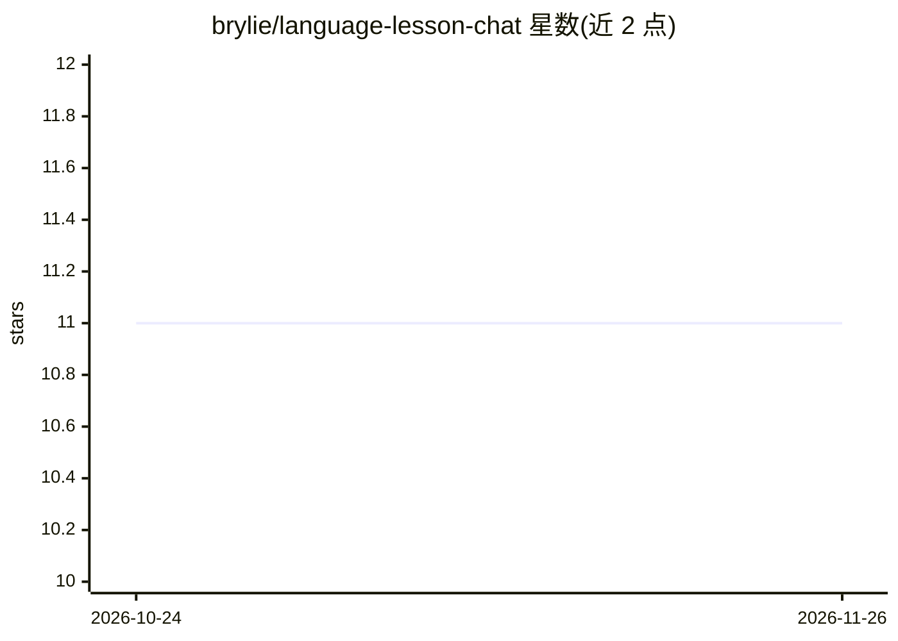

# brylie/language-lesson-chat

⭐ 11 · Python · EUPL-1.2 · 推送 2026-01-19 · [GitHub](https://github.com/brylie/language-lesson-chat) · 个人维护

**语言学习者的 AI 情境对话练习 Web 应用**

基于 Django 与 Wagtail CMS 构建的语言学习陪练 Web 应用：用户选择场景课程（从咖啡馆点餐到机场问路）与 A1–C2 难度等级后，与 AI 语言伙伴进行动态对话，AI 会按使用者水平自适应输出，并结合课程指定词汇与语言概念给出反馈；对话具备持久记忆以保持上下文连贯，每课配图提供视觉情境。前端交互使用 HTMX，部署指南面向 DigitalOcean App Platform，许可证为 EUPL v1.2。安装一节在 README 中尚未填写。

## 筛选速览

| 维度 | 判定 | 备注 |
|---|---|---|
| AI 角色 | `ai-native` | 本体是模型或模型工具 |
| 许可风险 | `viral` | EUPL-1.2 |
| 部署形态 | `None` |  |
| 模型依赖 | — | README 未给出锁定关系 |
| 硬件要求 | — | 无带数字的原话,不猜 |
| 安装摩擦 | `low` | 无编译、无系统依赖或容器化 |
| 成熟度 | — | 结构信号不足 |

## 能力要点

- AI 对话伙伴按使用者熟练度自适应并保持持久对话记忆
- 按 A1–C2 难度分级的多场景情境课程，每课含配图与重点词汇
- Django + Wagtail CMS 内容管理，HTMX 交互

## 适用场景

- 语言学习者在真实情境中练习目标语言对话
- 教师为语言教学寻找互动练习辅助工具
- 自学者为真实语言使用场景做准备

## 场景标签

`聊天机器人` · 领域:对话与助手

## 证据(README 行号)

> L5: The Language Learning AI Companion is an innovative web application designed to help language learners practice thei
> L9: - **AI-Powered Conversations**: Engage in dynamic dialogues with an AI language partner that adapts to your proficie
> L36: - Utilizes advanced language models for natural conversation generation

## 星数曲线

2026-10-24 11 → 2026-11-26 11（+0）

---
*卡片 v1 · prompt 1.4 · 生成 2026-11-18 · 置信度 high · 依据 README sha `06853c8a78b4` · [字段定义](../../DATASET.md)*
