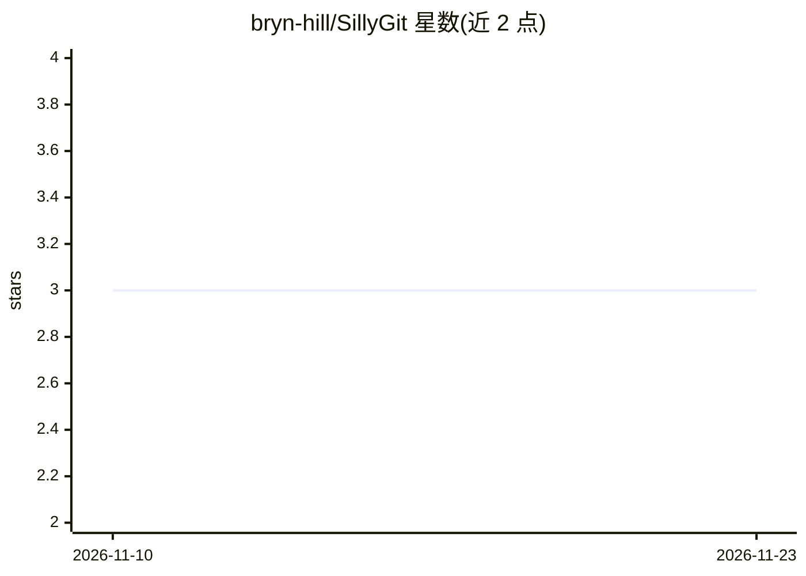

# bryn-hill/SillyGit

⭐ 3 · TypeScript · MIT · 推送 2026-11-22 · [GitHub](https://github.com/bryn-hill/SillyGit) · [官网](https://bryn-hill.github.io/SillyGit/) · 个人维护

**内置 Claude Code 的桌面 Git 客户端，带合并编辑器与提交图**

基于 Electron 的跨平台桌面 Git 客户端（macOS/Windows，Linux 需自行构建），提供提交图、逐行暂存、三路合并冲突编辑器、多分支 lanes、交互式 rebase、git bisect、PR 审查（GitHub/Azure DevOps）与 Jira 工单联动。AI 部分：侧栏运行 Claude Code，编辑文件或执行命令前先请求批准并展示 diff，另有 AI 审查 diff、生成 commit message、拆分大提交与冲突解决建议。构建未签名，不自更新；所有 Git 操作调用本机已有 git。

## 筛选速览

| 维度 | 判定 | 备注 |
|---|---|---|
| AI 角色 | `ai-enhanced` | 去掉 AI 部分产品仍成立 |
| 许可风险 | `permissive` | MIT |
| 部署形态 | `desktop` | 安装包/桌面程序 |
| 模型依赖 | locked-api |  |
| 硬件要求 | — | 无带数字的原话,不猜 |
| 安装摩擦 | `medium` | 含编译或系统依赖之一 |
| 成熟度 | `idea` | |

## 能力要点

- 侧栏运行 Claude Code，编辑/执行前先批准并展示 diff
- 三路合并编辑器与冲突 AI 解决建议
- 多分支 lanes：一个工作区同时检出多条分支各自提交
- 基于 reflog 的 Undo 与 Run in isolation 隔离运行任意提交

## 适用场景

- 在图形界面里完成提交图浏览、逐行暂存与冲突解决
- 不切换分支即可试运行 PR 上的提交
- 让 Claude 在当前仓库里改代码并逐条批准其修改
- 从 issue/Jira 工单一键建分支并关联 commit 与 PR

## 场景标签

`编码 Agent` `代码审查` · 领域:编码与开发

## 证据(README 行号)

> L5: **A desktop Git client with a commit graph, line staging, a three-way merge editor and Claude Code built in.**
> L16: SillyGit is free and MIT licensed. Besides the graph, staging and conflict tools, it handles
> L189: - A Claude panel that runs Claude Code inside the app, asks permission before edits

## 星数曲线

2026-11-10 3 → 2026-11-23 3（+0）

---
*卡片 v1 · prompt 1.4 · 生成 2026-11-22 · 置信度 high · 依据 README sha `d0d4f07c26f8` · [字段定义](../../DATASET.md)*
