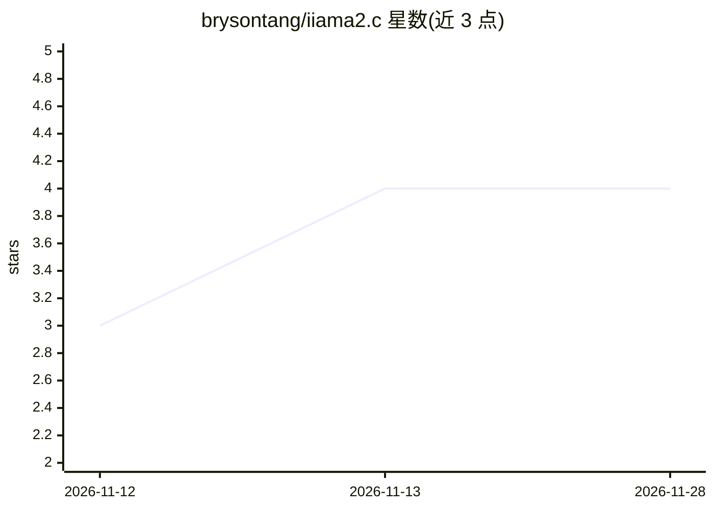

# brysontang/iiama2.c

⭐ 4 · C · MIT · 推送 2026-10-16 · [GitHub](https://github.com/brysontang/iiama2.c) · 个人维护

**在任天堂 Wii 上运行 TinyStories 类 LLM 的移植项目**

将 Karpathy 的 llama2.c 移植到 Nintendo Wii：在 88 MB 内存、729 MHz PowerPC 主机上运行 260K 至约 42M 参数的 TinyStories 类模型，并把生成的故事输出到电视，用 Wii Remote 交互控制。关键机制是利用固定功能 GPU 的 TEV 纹理组合器执行 8 位乘加实现 matmul，提供 CPU/split/GPU 等多种引擎，GPU fast 引擎在 stories15M 上达到 61.9 tok/s。需要已装 Homebrew Channel 的 Wii、SD 卡，PC 端需 uv 与 devkitPro 或 Docker 构建。

## 筛选速览

| 维度 | 判定 | 备注 |
|---|---|---|
| AI 角色 | `ai-native` | 本体是模型或模型工具 |
| 许可风险 | `permissive` | MIT |
| 部署形态 | `self-host` | docker 或自建部署 |
| 模型依赖 | — | README 未给出锁定关系 |
| 硬件要求 | — | 无带数字的原话,不猜 |
| 安装摩擦 | `low` | 无编译、无系统依赖或容器化 |
| 成熟度 | — | 结构信号不足 |

## 能力要点

- 利用 Wii TEV 纹理组合器做 8 位乘加的 GPU matmul 引擎
- 提供 CPU/split/GPU fast/GPU exact 四种计算引擎
- stories15M 最快引擎 61.9 tok/s，为纯 CPU 的 4.9 倍
- 带自检哈希、精度（Top-1/KL/困惑度）与逐 token 性能剖析

## 适用场景

- 在 Wii 真机上离线生成 TinyStories 故事
- 研究在无着色器固定功能 GPU 上实现 matmul
- 对 llama2.c 推理做性能与精度对比实验

## 场景标签

`推理引擎` · 领域:训练与推理

## 证据(README 行号)

> L3: Karpathy's llama2.c, ported to the Nintendo Wii.
> L5: GPU prices are out of control, so we're working with what we've got: a game console from 2006, 88 MB of RAM, and a 7

## 星数曲线

2026-11-12 3 → 2026-11-28 4（+1）

---
*卡片 v1 · prompt 1.4 · 生成 2026-11-21 · 置信度 high · 依据 README sha `0d4429fe20cc` · [字段定义](../../DATASET.md)*
