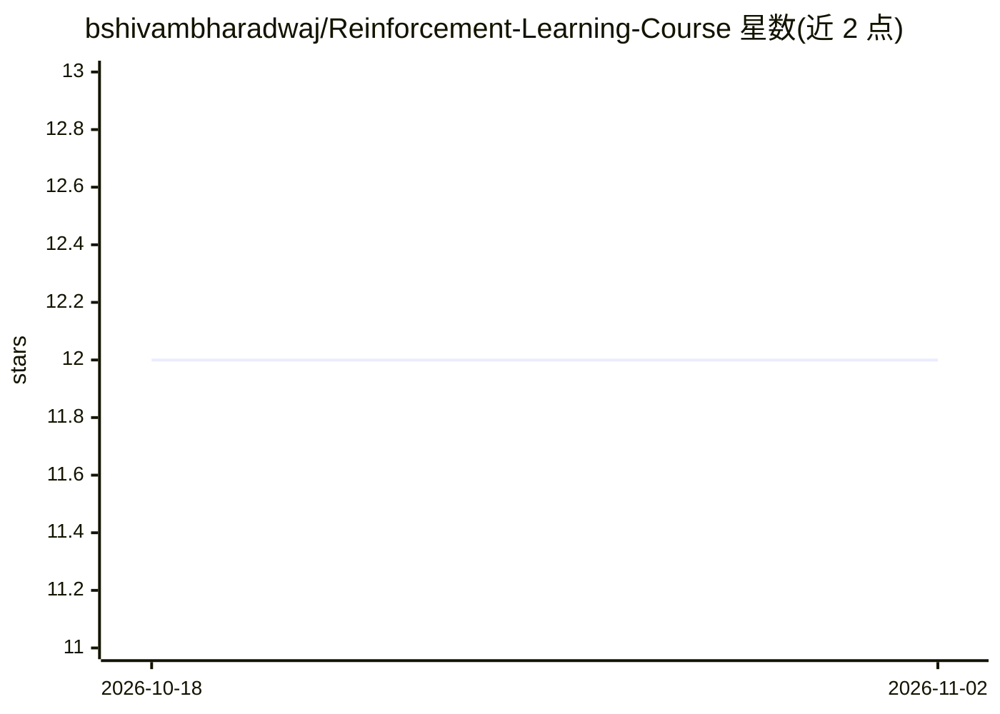

# bshivambharadwaj/Reinforcement-Learning-Course

⭐ 12 · Jupyter Notebook · NOASSERTION · 推送 2026-09-17 · [GitHub](https://github.com/bshivambharadwaj/Reinforcement-Learning-Course) · 个人维护

**从 Bellman 方程到推理 agent 的强化学习课程（48 章节+14 notebook）**

面向已具备 Python 与机器学习基础的开发者、研究者与学生的强化学习课程：按经典 RL→深度 RL→后训练（RLHF/DPO/GRPO）→agent→推理期推理的顺序组织 48 个主题，配套 14 个可运行 notebook（含保存结果与练习）。以配送机器人为贯穿示例，旗舰项目 GoalLab 让学习者构建计划-行动-验证的 agent，含 14 阶段构建与本地 demo（无需 API key）。先修要求为 Python、微积分、概率与线性代数，无需 RL 经验。

## 筛选速览

| 维度 | 判定 | 备注 |
|---|---|---|
| AI 角色 | `ai-knowledge` | 知识聚合/清单类 |
| 许可风险 | `none` | NOASSERTION |
| 部署形态 | `library` | 以包/库形式分发 |
| 模型依赖 | — | README 未给出锁定关系 |
| 硬件要求 | — | 无带数字的原话,不猜 |
| 安装摩擦 | `low` | 无编译、无系统依赖或容器化 |
| 成熟度 | — | 结构信号不足 |

## 能力要点

- 48 主题覆盖 Q-learning、PPO、RLHF、DPO、GRPO 到推理期推理
- 14 个 notebook 含保存结果、正确性检查与带提示练习
- 旗舰项目 GoalLab：构建计划-行动-验证的 agent，14 阶段构建
- 独立失败模式章节（稀疏奖励、策略崩溃、评估器博弈等）

## 适用场景

- 系统学习从经典 RL 到 LLM 对齐与推理模型的完整脉络
- 动手微调真实小语言模型并训练工具选择 agent
- 在统一任务上对比多种 RL 算法与搜索策略

## 场景标签

`教程课程` `强化学习` · 领域:学习与行业

## 证据(README 行号)

> L5: **48 topics • 14 course notebooks • 14 GoalLab stages • Classical RL → Inference-Time Reasoning**
> L17: **Choose your reading depth:** select a topic below for its quick read, then follow its chapter link for deeper stu

## 星数曲线

2026-10-18 12 → 2026-11-02 12（+0）

---
*卡片 v1 · prompt 1.4 · 生成 2026-11-01 · 置信度 mid · 依据 README sha `c3080c6c9698` · [字段定义](../../DATASET.md)*
