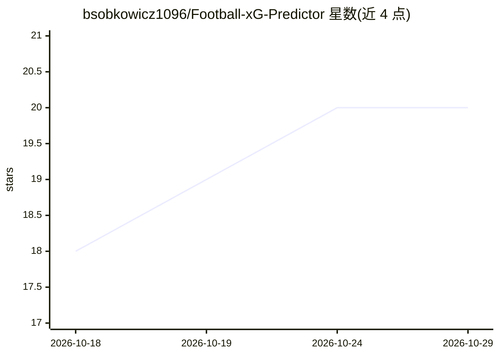

# bsobkowicz1096/Football-xG-Predictor

⭐ 20 · Jupyter Notebook · 推送 2026-07-19 · [GitHub](https://github.com/bsobkowicz1096/Football-xG-Predictor) · 个人维护

**基于 StatsBomb 数据的足球 xG 概率预测模型**

基于 StatsBomb 开放数据的足球预期进球（xG）建模项目：训练并比较 Logistic Regression、Random Forest 与 XGBoost，使用 Hyperopt 调参与 4 折分层交叉验证，以 2022 世界杯数据作为真实样本外测试集。特征工程覆盖射门几何、freeze-frame 防守信息、技术动作与比赛情境共 15 个特征，并比较 Beta/Isotonic/Platt 三种校准方法，用 SHAP 做特征重要性解释。仓库不含数据文件，需运行脚本自行采集，主流程以 Jupyter notebook 形式提供。

## 筛选速览

| 维度 | 判定 | 备注 |
|---|---|---|
| AI 角色 | `ai-native` | 本体是模型或模型工具 |
| 许可风险 | `none` | — |
| 部署形态 | `library` | 以包/库形式分发 |
| 模型依赖 | — | README 未给出锁定关系 |
| 硬件要求 | — | 无带数字的原话,不猜 |
| 安装摩擦 | `low` | 无编译、无系统依赖或容器化 |
| 成熟度 | — | 结构信号不足 |

## 能力要点

- 三种模型对比 + Hyperopt 调参 + 4 折分层 CV
- FIFA 2022 世界杯数据作为真实样本外测试集
- 15 个特征覆盖几何/防守/技术/情境信息
- Beta/Isotonic/Platt 校准比较与 SHAP 可解释性

## 适用场景

- 构建自己的足球 xG 模型用于比赛与球员分析
- 学习特征工程、模型校准与可解释性分析流程
- 基于 StatsBomb 开放数据做体育分析练习

## 场景标签

 · 领域:体育数据科学

## 证据(README 行号)

> L5: An Expected Goals (xG) model that predicts the probability of scoring based on StatsBomb open data. The project trai
> L9: Expected Goals (xG) is one of the most important metrics in modern football analytics. It allows for evaluating shot

## 星数曲线

2026-10-18 18 → 2026-10-29 20（+2）

---
*卡片 v1 · prompt 1.4 · 生成 2026-10-28 · 置信度 mid · 依据 README sha `300999e78b70` · [字段定义](../../DATASET.md)*
