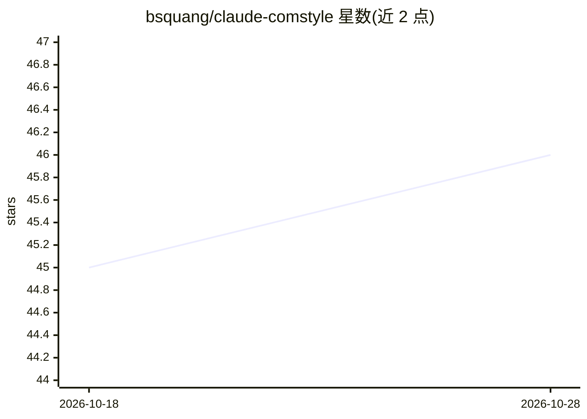

# bsquang/claude-comstyle

⭐ 46 · Unlicense · 推送 2026-04-25 · [GitHub](https://github.com/bsquang/claude-comstyle) · [官网](https://github.com/bsquang/claude-comstyle#readme) · 个人维护

**13 条控制 Claude 输出风格的提示词集合，按需复制粘贴**

面向开发者的 Claude 沟通风格提示词合集：提供 Military、Caveman、BLUF、git log、Yoda、Pirate 等 13 种风格，每种附完整提示词文本、Before/After 对比示例及优缺点说明；总览表按输出 token 增减幅度标注适用与不适用场景。使用方式为复制提示词粘贴到对话开头，或写入 ~/.claude/CLAUDE.md 使其对所有会话生效；另有 terminal CLI style 后缀可进一步去除 markdown 输出。README 声明仅在 Claude 上测试，其他 AI 助手不保证效果。提供英文与越南语双语版本。

## 筛选速览

| 维度 | 判定 | 备注 |
|---|---|---|
| AI 角色 | `ai-knowledge` | 知识聚合/清单类 |
| 许可风险 | `permissive` | Unlicense |
| 部署形态 | `None` |  |
| 模型依赖 | — | README 未给出锁定关系 |
| 硬件要求 | — | 无带数字的原话,不猜 |
| 安装摩擦 | `low` | 无编译、无系统依赖或容器化 |
| 成熟度 | — | 结构信号不足 |

## 能力要点

- 13 种沟通风格提示词，附 token 增减幅度总览表
- 每种风格含提示词全文与 Before/After 输出对比
- 支持写入 ~/.claude/CLAUDE.md 实现永久生效
- terminal CLI style 后缀可额外减少约 20–30% 输出 token

## 适用场景

- 调试时切换到简短风格减少输出 token 与阅读负担
- 做方案评估时使用 Reality Check 获得直白判断
- 学习新概念时切换 Feynman 或 Socratic 风格

## 场景标签

`提示工程` · 领域:Agent 开发

## 证据(README 行号)

> L11: Pick a style from the table → copy the prompt → paste at the start of your chat.
> L13: Want it permanent? Add to `~/.claude/CLAUDE.md` — active for every session.

## 星数曲线

2026-10-18 45 → 2026-10-28 46（+1）

---
*卡片 v1 · prompt 1.4 · 生成 2026-10-25 · 置信度 high · 依据 README sha `3f74fbbe256e` · [字段定义](../../DATASET.md)*
