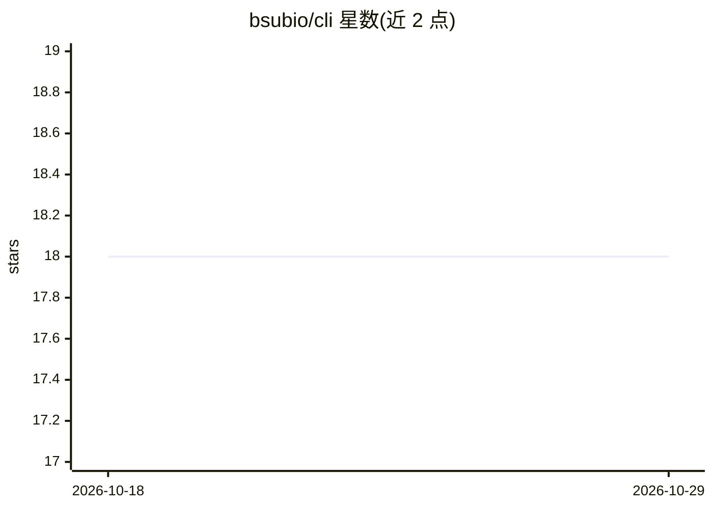

# bsubio/cli

⭐ 18 · Go · MIT · 推送 2025-11-25 · [GitHub](https://github.com/bsubio/cli) · [官网](https://www.bsub.io) · 组织维护

**bsub.io 批处理云服务的命令行客户端：提交/查询批处理任务**

bsub.io 在线批处理服务的 CLI 工具：用户通过 register 命令注册账号并获取 API key（配置存于 ~/.config/bsubio/config.json），随后可用 submit 将文件任务（如 pdf/extract、pdf/extract/ocr）提交到 bsub.io 云端基础设施执行，并以 jobs/status/cat 命令查看任务列表、状态与输出。支持 Linux/macOS/Windows 多平台二进制分发与 Go 源码构建。推理与转换均在云端完成，CLI 仅负责任务提交与结果读取。

## 筛选速览

| 维度 | 判定 | 备注 |
|---|---|---|
| AI 角色 | `ai-ecosystem` | LLM/agent 周边工具 |
| 许可风险 | `permissive` | MIT |
| 部署形态 | `desktop` | 安装包/桌面程序 |
| 模型依赖 | — | README 未给出锁定关系 |
| 硬件要求 | — | 无带数字的原话,不猜 |
| 安装摩擦 | `low` | 无编译、无系统依赖或容器化 |
| 成熟度 | — | 结构信号不足 |

## 能力要点

- submit/jobs/status/cat 命令覆盖任务提交、列表、状态查询与输出读取
- 工作流示例含 pdf/extract 与 pdf/extract/ocr（OCR）
- curl 脚本一键安装，自动检测 OS/架构、校验 checksum
- 为 Linux x86_64/ARM64、macOS Intel/Apple Silicon、Windows 提供预编译二进制

## 适用场景

- 把 PDF 提取、OCR 等批处理任务提交到 bsub.io 云端执行
- 在脚本中批量提交任务并跟踪任务状态与输出
- 注册并管理 bsub.io 账号与 API key 配置

## 场景标签

`文档解析` `OCR` · 领域:知识与检索

## 证据(README 行号)

> L3: Command-line interface for bsub.io batch processing service.
> L82: This will submit the file `input.txt` that we just created with its sample "123" string to `bsub.io` infrastructure
> L94:  $ bsubio submit -w pdf/extract/ocr your.pdf

## 星数曲线

2026-10-18 18 → 2026-10-29 18（+0）

---
*卡片 v1 · prompt 1.4 · 生成 2026-10-29 · 置信度 mid · 依据 README sha `fb4eab657185` · [字段定义](../../DATASET.md)*
