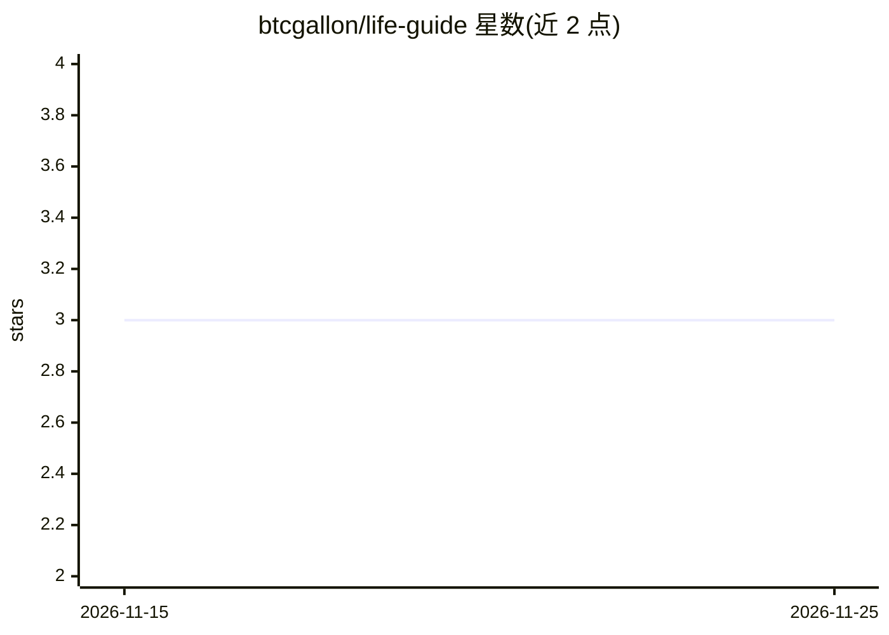

# btcgallon/life-guide

⭐ 3 · HTML · NOASSERTION · 推送 2026-11-11 · [GitHub](https://github.com/btcgallon/life-guide) · 个人维护 · 中文 README

**离线知识库网页：检索两本生活指南并分层给出结论与忠告**

把《高性价比人生指南》（671 条 / 34 节）与《程序员延寿指南》解析为结构化条目，构建为单文件 HTML 网页。未配置 API Key 时可浏览与全文检索全部条目；贴入 Key 后，输入问题即按五步流程在同一页给出思考进度、一句话结论、分层分点忠告，并标注「第X节第Y条」可跳转出处；检索不到相关条目时如实说明。可选接入本机 Ollama 实现全离线使用，另附 Node 本机转发服务以规避跨域。

## 筛选速览

| 维度 | 判定 | 备注 |
|---|---|---|
| AI 角色 | `ai-knowledge` | 知识聚合/清单类 |
| 许可风险 | `none` | NOASSERTION |
| 部署形态 | `None` |  |
| 模型依赖 | local-ok | 支持本地模型 |
| 硬件要求 | — | 无带数字的原话,不猜 |
| 安装摩擦 | `low` | 无编译、无系统依赖或容器化 |
| 成熟度 | — | 结构信号不足 |

## 能力要点

- 671 条循证条目，34 节，支持按节浏览或全文检索
- 单文件 HTML 分发，对方自行贴 API Key 即可使用
- 结论附可跳转出处，检索不到时明示不编造
- 支持硅基流动、豆包、DeepSeek、智谱、腾讯混元与本机 Ollama

## 适用场景

- 遇到生活或健康问题时查书并获取分层建议
- 把两本指南打包成单文件发给他人离线查阅
- 无网络环境下用 Ollama 本机模型完成检索问答

## 场景标签

`文档问答` · 领域:知识与检索

## 证据(README 行号)

> L5: **知识库完全离线可用**；贴入自己的 API Key 后，写下一件正在困扰你的事，它先查书，再按层给结论、给忠告，并标出「第几节第几条」。
> L11: - **671 条**循证条目，34 节，可按节浏览或全文检索
> L25: 不配置 Key 也能浏览、搜索全部条目。

## 星数曲线

2026-11-15 3 → 2026-11-25 3（+0）

---
*卡片 v1 · prompt 1.4 · 生成 2026-11-22 · 置信度 mid · 依据 README sha `6a175500e403` · [字段定义](../../DATASET.md)*
