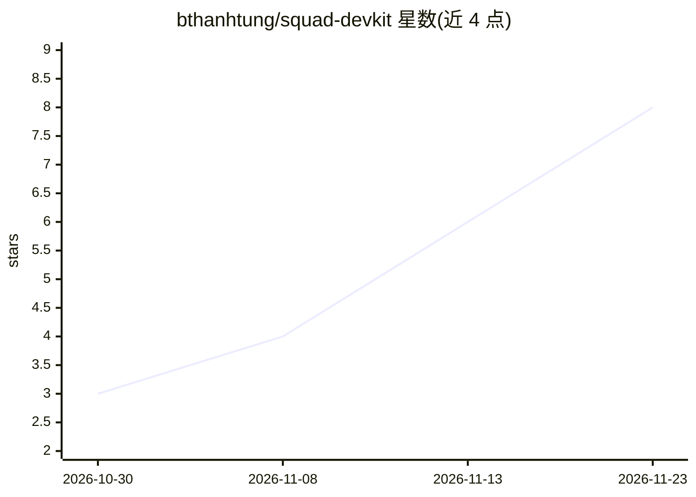

# bthanhtung/squad-devkit

⭐ 8 · Shell · GPL-3.0 · 推送 2026-11-22 · [GitHub](https://github.com/bthanhtung/squad-devkit) · 个人维护

**多 agent 编码编排 CLI：经理规划、worker 隔离构建、合并前校验**

以终端 CLI 形式运行的多 agent 编码编排工具：由一个 manager agent 负责规划与校验，把任务分发给按需启动的 worker，每个 worker 在独立 git worktree 与分支中编辑，manager 审阅 diff、重跑检查后才合并。机制上包含时间限制与卡死检测、守卫 hook 阻止 manager 编辑项目文件、未经批准禁止 commit/push，以及 Rust 编写的消息总线（SQLite）。需要 macOS/Linux、bash、git 与至少一个引擎 CLI。

## 筛选速览

| 维度 | 判定 | 备注 |
|---|---|---|
| AI 角色 | `ai-ecosystem` | LLM/agent 周边工具 |
| 许可风险 | `viral` | GPL-3.0 |
| 部署形态 | `None` |  |
| 模型依赖 | — | README 未给出锁定关系 |
| 硬件要求 | — | 无带数字的原话,不猜 |
| 安装摩擦 | `low` | 无编译、无系统依赖或容器化 |
| 成熟度 | — | 结构信号不足 |

## 能力要点

- manager 规划校验、worker 在独立 git worktree 并行编辑
- 支持 claude、codex、opencode、grok、ccr 五种引擎适配
- 守卫 hook 限制 manager 只能写 .squad/，合并需用户批准
- Rust 编写的消息总线与任务存储（.squad/messages.db）

## 适用场景

- 把一个终端当作工程小组，并行派发修复、测试、文档任务
- 用便宜模型执行编辑、用更强模型做规划与审查以控制 token 消耗
- 在合并前要求 diff 审阅与测试重跑的团队工作流

## 场景标签

`多智能体` `编码 Agent` · 领域:Agent 开发

## 证据(README 行号)

> L10: squad-devkit turns one terminal into an engineering team. You talk to one manager agent.
> L58: |`squad-worker`|Validates the plan, creates the worktree, starts an engine adapter (`scripts/lib/engines/`: claude,

## 星数曲线

2026-10-30 3 → 2026-11-23 8（+5）

---
*卡片 v1 · prompt 1.4 · 生成 2026-11-20 · 置信度 high · 依据 README sha `7d62b76bb133` · [字段定义](../../DATASET.md)*
