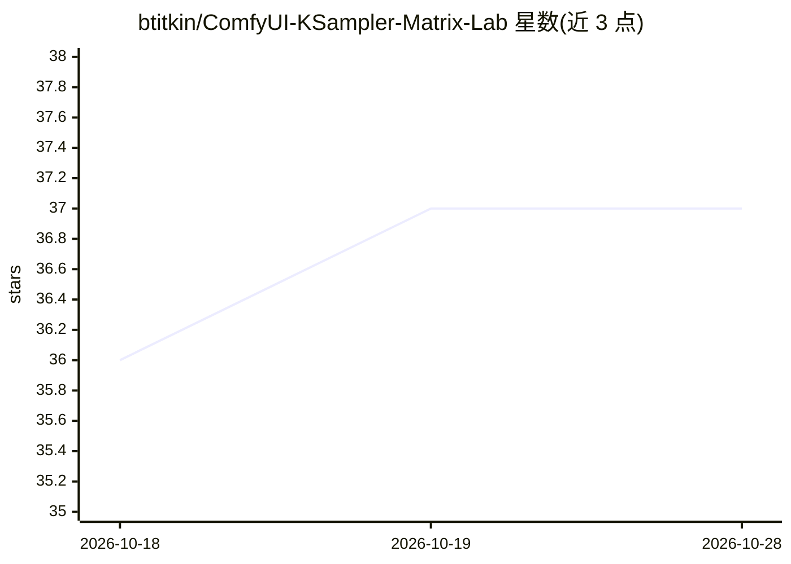

# btitkin/ComfyUI-KSampler-Matrix-Lab

⭐ 37 · Python · MIT · 推送 2026-07-08 · [GitHub](https://github.com/btitkin/ComfyUI-KSampler-Matrix-Lab) · 个人维护

**ComfyUI 节点集：生成采样器/调度器/模型的对比网格图**

面向 ComfyUI 用户的自定义节点集，提供 KSampler Matrix Lab 与 Model Matrix Lab 两个节点：前者对最多 9 个采样器与 9 个调度器组合生成带标签的输出网格，后者对最多 20 个已安装模型在共享生成设置下做对比；采样器与调度器下拉列表从本地 ComfyUI 安装动态读取，逐张顺序生成以避免大批量。附带示例工作流 JSON，以 MIT 许可发布，运行行为依赖用户的 ComfyUI 版本与已装模型。

## 筛选速览

| 维度 | 判定 | 备注 |
|---|---|---|
| AI 角色 | `ai-ecosystem` | LLM/agent 周边工具 |
| 许可风险 | `permissive` | MIT |
| 部署形态 | `None` |  |
| 模型依赖 | — | README 未给出锁定关系 |
| 硬件要求 | — | 无带数字的原话,不猜 |
| 安装摩擦 | `low` | 无编译、无系统依赖或容器化 |
| 成熟度 | — | 结构信号不足 |

## 能力要点

- 采样器×调度器组合网格（各最多 9 槽位）
- 最多 20 个模型的对比节点
- 同种子与逐格递增两种种子模式
- 逐格标签、错误占位格与组合数安全上限

## 适用场景

- 用同一提示词与种子对比不同采样器/调度器效果
- 并排比较多个已安装的 checkpoint 模型
- 为模型笔记或美术方向评审生成可视化对比图

## 场景标签

`图像生成` · 领域:内容生成

## 证据(README 行号)

> L3: ComfyUI KSampler Matrix Lab adds custom ComfyUI nodes for generating labeled sampler, scheduler and model comparison
> L31: - `KSampler Matrix Lab` node for sampler and scheduler comparison grids.

## 星数曲线

2026-10-18 36 → 2026-10-28 37（+1）

---
*卡片 v1 · prompt 1.4 · 生成 2026-10-25 · 置信度 high · 依据 README sha `1bfb572ffd10` · [字段定义](../../DATASET.md)*
