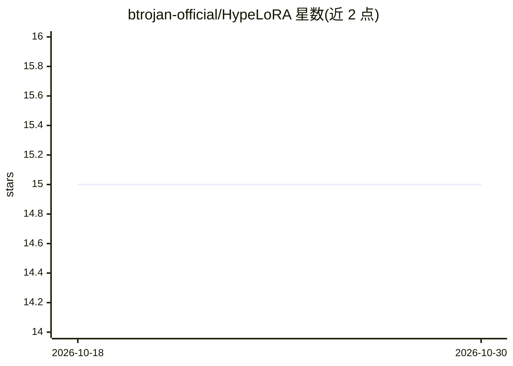

# btrojan-official/HypeLoRA

⭐ 15 · Python · 推送 2026-07-27 · [GitHub](https://github.com/btrojan-official/HypeLoRA) · 个人维护

**超网络生成 LoRA 适配器的研究代码：校准感知微调**

随论文发布的实验代码库：用共享超网络（MLP 或 Transformer 编码器）在每次前向传播时生成 RoBERTa 各层的 LoRA 矩阵（A/B），骨干参数保持冻结；支持固定 A 仅生成 B 的正则化变体、噪声混合退火等机制。每次评估同时计算 ECE、CECE、MCE、ACE、TACE 与 Brier Score，覆盖 8 个 GLUE 任务，实验通过单一入口脚本加 Python 配置文件驱动，日志记录到 WandB 并保存 CSV。

## 筛选速览

| 维度 | 判定 | 备注 |
|---|---|---|
| AI 角色 | `ai-native` | 本体是模型或模型工具 |
| 许可风险 | `none` | — |
| 部署形态 | `None` |  |
| 模型依赖 | — | README 未给出锁定关系 |
| 硬件要求 | — | 无带数字的原话,不猜 |
| 安装摩擦 | `low` | 无编译、无系统依赖或容器化 |
| 成熟度 | — | 结构信号不足 |

## 能力要点

- 共享超网络（4 层 MLP 或 2 层 Transformer）逐层生成 LoRA 权重
- 固定 A 仅生成 B 的变体作为正则化手段降低 ECE
- 每次评估计算 ECE/CECE/MCE/ACE/TACE/Brier 六种校准指标
- 支持 8 个 GLUE 任务，含全量微调与标准 LoRA 基线配置

## 适用场景

- 复现论文中的 LoRA 与超网络校准实验
- 研究参数高效微调对模型校准的影响
- 在 GLUE 任务上比较不同适配方法的 ECE 与任务指标

## 场景标签

`微调` · 领域:训练与推理

## 证据(README 行号)

> L13: Modern Transformer-based models frequently suffer from miscalibration, producing overconfident predictions that do 
> L17: Standard LoRA adapters are static — once trained, each layer uses a fixed pair of low-rank matrices **A** and **B**
> L25: - **Calibration-aware evaluation** — every evaluation step computes ECE, Classwise-ECE, MCE, ACE, Thresholded ACE, 

## 星数曲线

2026-10-18 15 → 2026-10-30 15（+0）

---
*卡片 v1 · prompt 1.4 · 生成 2026-10-30 · 置信度 high · 依据 README sha `c69807e77903` · [字段定义](../../DATASET.md)*
