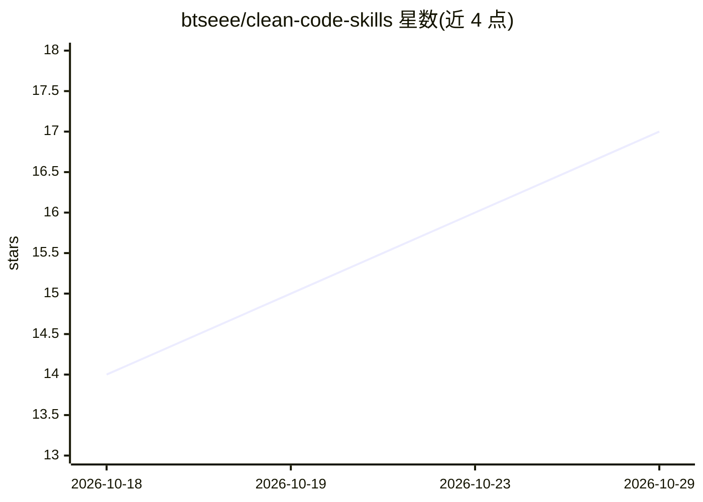

# btseee/clean-code-skills

⭐ 17 · Python · MIT · 推送 2026-09-25 · [GitHub](https://github.com/btseee/clean-code-skills) · 个人维护

**给 AI 编码代理的整洁代码/整洁架构技能包**

以 Agent Skills / AGENTS.md 格式提供的技能与规则包：覆盖 21 种语言、27 种框架的分层规则包，配合结构映射脚本（Python 3.8+）扫描项目文件，报告错位、重复、职责混杂、命名与依赖循环等发现，并将栈、层级与历史决策存入 .clean/ 目录以跨会话保持上下文。提供 7 个命令（init/audit/clean-up/plan/review 等），兼容 Claude Code、Codex、Cursor、GitHub Copilot、Gemini CLI、Windsurf、Cline 等宿主，通过 curl/PowerShell 脚本、npx 或 Claude Code 插件市场安装；脚本仅读写本地文件、不联网。

## 筛选速览

| 维度 | 判定 | 备注 |
|---|---|---|
| AI 角色 | `ai-ecosystem` | LLM/agent 周边工具 |
| 许可风险 | `permissive` | MIT |
| 部署形态 | `library` | 以包/库形式分发 |
| 模型依赖 | — | README 未给出锁定关系 |
| 硬件要求 | — | 无带数字的原话,不猜 |
| 安装摩擦 | `low` | 无编译、无系统依赖或容器化 |
| 成熟度 | — | 结构信号不足 |

## 能力要点

- 21 种语言、27 种框架的规则包，按项目实际栈加载
- 结构映射脚本输出错位/重复/依赖循环等发现
- .clean/ 目录保存栈、层级与进度，跨会话恢复
- 常驻规则与技能控制在 750/1500 token 以内

## 适用场景

- 让编码代理在改代码前先加载项目上下文与整洁架构规则
- 对现有代码库做结构审计与分批清理
- 评审 diff 时按清单与 10 类代理坏味道输出发现
- 在设计新项目时先规划结构与层级

## 场景标签

`提示工程` · 领域:Agent 开发

## 证据(README 行号)

> L9: Clean code and clean architecture for AI coding agents: one skill, rule packs for 21 languages and
> L11: belongs there. Works with Claude Code, Codex, Cursor, GitHub Copilot, Gemini CLI, Windsurf, Cline,
> L23: This skill makes an agent load the project's context first, apply the rules of *Clean Code* and

## 星数曲线

2026-10-18 14 → 2026-10-29 17（+3）

---
*卡片 v1 · prompt 1.4 · 生成 2026-10-29 · 置信度 high · 依据 README sha `abdbd3a6de4f` · [字段定义](../../DATASET.md)*
