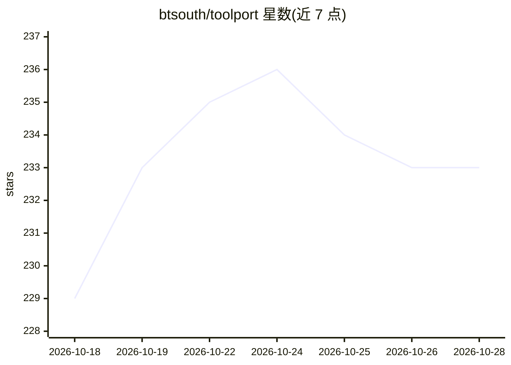

# btsouth/toolport

⭐ 233 · Rust · MIT · 推送 2026-10-25 · [GitHub](https://github.com/btsouth/toolport) · [官网](https://toolport.app) · 个人维护

**本地优先的 MCP 网关：一次配置 MCP 服务器供各 AI 客户端共用**

面向使用 Claude、Cursor、Codex、VS Code 等 AI 客户端的开发者的本地 MCP 网关：添加并认证 MCP 服务器一次，即可在多个客户端间共享，通过访问集控制各客户端可触达的服务器。凭据存于操作系统密钥链而非客户端配置中；支持禁用工具、对破坏性调用要求审批、统一查看活动记录；提供按需工具搜索以减少上下文开销。提供 Windows/macOS/Linux 桌面安装包，另有 Teams 版本与无头网关 Docker 部署方式。

## 筛选速览

| 维度 | 判定 | 备注 |
|---|---|---|
| AI 角色 | `ai-ecosystem` | LLM/agent 周边工具 |
| 许可风险 | `permissive` | MIT |
| 部署形态 | `None` |  |
| 模型依赖 | — | README 未给出锁定关系 |
| 硬件要求 | — | 无带数字的原话,不猜 |
| 安装摩擦 | `low` | 无编译、无系统依赖或容器化 |
| 成熟度 | — | 结构信号不足 |

## 能力要点

- 一次配置 MCP 服务器，跨 Claude/Cursor/Codex/VS Code 等客户端共享
- 凭据存于 OS 密钥链，访问集按客户端控制服务器可达范围
- 按需工具搜索减少客户端每次请求加载全部工具定义的开销
- 支持禁用工具、破坏性调用审批与集中活动审查

## 适用场景

- 多个 AI 客户端共用同一套 MCP 服务器配置与凭据
- 控制各客户端可访问哪些 MCP 服务器和工具
- 减少上下文占用：代理按需搜索工具而非全量加载
- 团队共享服务器配置与策略，成员各自保管凭据

## 场景标签

`模型网关` · 领域:Agent 开发

## 证据(README 行号)

> L11: Toolport is a local gateway for MCP, the protocol that gives AI apps access to
> L13: them across Claude, Cursor, Codex, VS Code, and other clients.

## 星数曲线

2026-10-18 229 → 2026-10-28 233（+4）

---
*卡片 v1 · prompt 1.4 · 生成 2026-10-22 · 置信度 high · 依据 README sha `1bf94a50c08f` · [字段定义](../../DATASET.md)*
