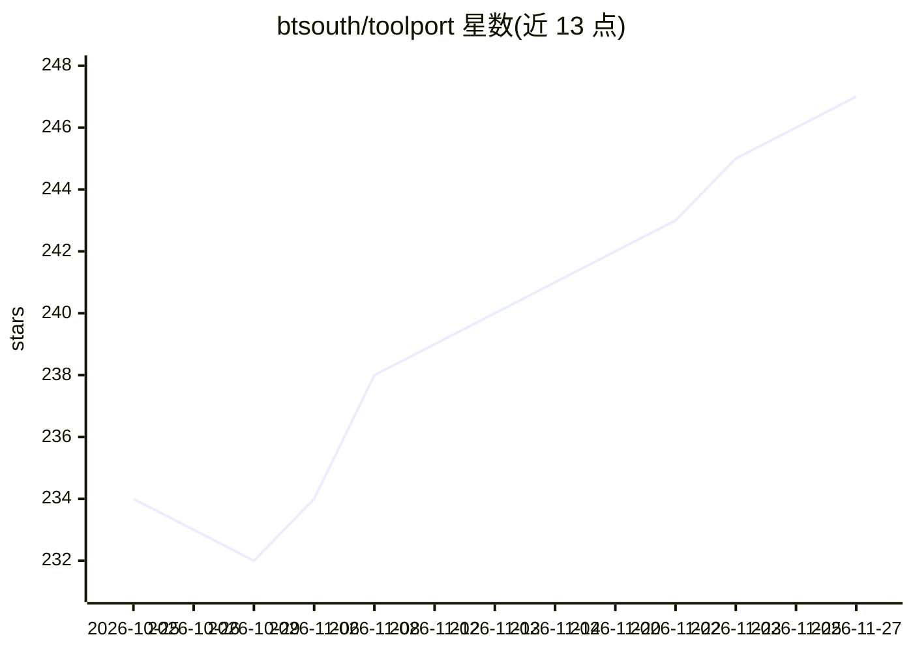

# btsouth/toolport

⭐ 247 · Rust · MIT · 推送 2026-11-26 · [GitHub](https://github.com/btsouth/toolport) · [官网](https://toolport.app) · 个人维护

**为多种编码 agent 提供统一配置检查与 MCP 网关的工具**

面向在机器上使用 Claude Code、Codex、Cursor、OpenCode 等 40+ 编码 agent 的开发者：各 agent 各自维护 MCP server、skills、rules 文件与凭证，Toolport 通过 npx CLI 一次性扫描明文密钥、M 配置漂移、失效 skill 链接与启动 token 占用，并支持 --fix 修复、toolport.toml 仓库级配置、usage 离线分析本地会话转录。桌面应用提供本地 MCP 网关、OS 钥匙串存密、工具定义固定与注入检测；Teams 版支持团队共享配置。MIT 许可。

## 筛选速览

| 维度 | 判定 | 备注 |
|---|---|---|
| AI 角色 | `ai-ecosystem` | LLM/agent 周边工具 |
| 许可风险 | `permissive` | MIT |
| 部署形态 | `library` | 以包/库形式分发 |
| 模型依赖 | — | README 未给出锁定关系 |
| 硬件要求 | — | 无带数字的原话,不猜 |
| 安装摩擦 | `low` | 无编译、无系统依赖或容器化 |
| 成熟度 | — | 结构信号不足 |

## 能力要点

- 单条 npx 命令扫描本机全部 agent 的密钥、漂移、skills 健康与 turn-0 token 预算
- toolport.toml 仓库清单：克隆后 toolport up 即可还原全部 agent 配置
- 本地 MCP 网关：一处配置，所有 agent 经同一入口访问，含访问集控制
- 安全机制：密钥移入 OS 钥匙串、工具定义固定、注入检测与 Ask/Strict 审批级别

## 适用场景

- 检查本机多个编码 agent 的 MCP 配置是否漂移或泄漏密钥
- 为仓库提交统一的 agent 配置清单供团队复用
- 分析各 agent 会话的 token 构成与缓存健康
- 用本地网关集中管理 MCP server 并控制各 agent 的访问范围

## 场景标签

 · 领域:开发者工具/AI agent 基础设施

## 证据(README 行号)

> L12: Claude Code, Codex, Cursor, OpenCode and 40+ other agents each keep their own MCP
> L38: |`npx @toolport/cli`|Check every agent: secrets on disk, MCP drift, skills and rules health, turn-0 token budget|
> L94: - **A local gateway for MCP.** Add a server once and every agent reaches it through

## 星数曲线

2026-10-25 234 → 2026-11-27 247（+13）

---
*卡片 v1 · prompt 1.4 · 生成 2026-11-26 · 置信度 high · 依据 README sha `b45a26bef3e2` · [字段定义](../../DATASET.md)*
