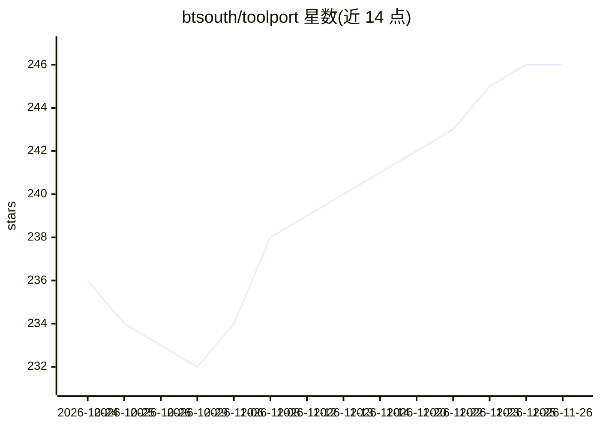

# btsouth/toolport

⭐ 246 · Rust · MIT · 推送 2026-11-25 · [GitHub](https://github.com/btsouth/toolport) · [官网](https://toolport.app) · 组织维护

**MCP 本地网关桌面应用：一次配置服务器，供所有 AI 客户端使用**

免费桌面应用与本地 MCP 网关：在本机扫描已安装的 AI 客户端并导入其服务器配置，为各客户端提供单一 Toolport 入口，支持访问集控制各客户端可达的服务器。密钥存入操作系统钥匙串，对工具定义做固定与变更标记，默认 Ask 级别拦截破坏性调用，Strict 级别隔离被改动的工具并阻断检测到的注入。对全量加载工具定义的客户端提供按需工具搜索以减少输入 token。支持 Windows/macOS/Linux 安装包、Arch pacman 仓库、Docker 无头网关，以及 Teams 团队同步（Pro/托管或自托管）。

## 筛选速览

| 维度 | 判定 | 备注 |
|---|---|---|
| AI 角色 | `ai-ecosystem` | LLM/agent 周边工具 |
| 许可风险 | `permissive` | MIT |
| 部署形态 | `None` |  |
| 模型依赖 | — | README 未给出锁定关系 |
| 硬件要求 | — | 无带数字的原话,不猜 |
| 安装摩擦 | `low` | 无编译、无系统依赖或容器化 |
| 成熟度 | — | 结构信号不足 |

## 能力要点

- 一次配置 MCP 服务器，40+ 客户端（Claude Code、Codex、Cursor、VS Code 等）共用
- API 密钥移入 OS 钥匙串，工具定义固定、变更标记与隔离
- 访问集控制各客户端可达服务器；按需工具搜索减少输入 token
- Pro 同步多机配置；Teams 支持托管与自托管的策略共享

## 适用场景

- 统一管理多个 AI 客户端的 MCP 服务器配置
- 把 API 密钥从明文配置迁移到系统钥匙串
- 监控并审批工具的破坏性调用与定义变更
- 团队共享服务器配置与策略，各成员保留自有凭据

## 场景标签

 · 领域:AI 基础设施/MCP 工具链

## 证据(README 行号)

> L11: Toolport is a free desktop app and local gateway for MCP, the protocol that gives
> L12: AI apps tools like GitHub, Linear and databases. Add a server once and Claude Code,
> L65: - Headless gateway and Docker

## 星数曲线

2026-10-24 236 → 2026-11-26 246（+10）

---
*卡片 v1 · prompt 1.4 · 生成 2026-11-25 · 置信度 high · 依据 README sha `57dea12d44ea` · [字段定义](../../DATASET.md)*
