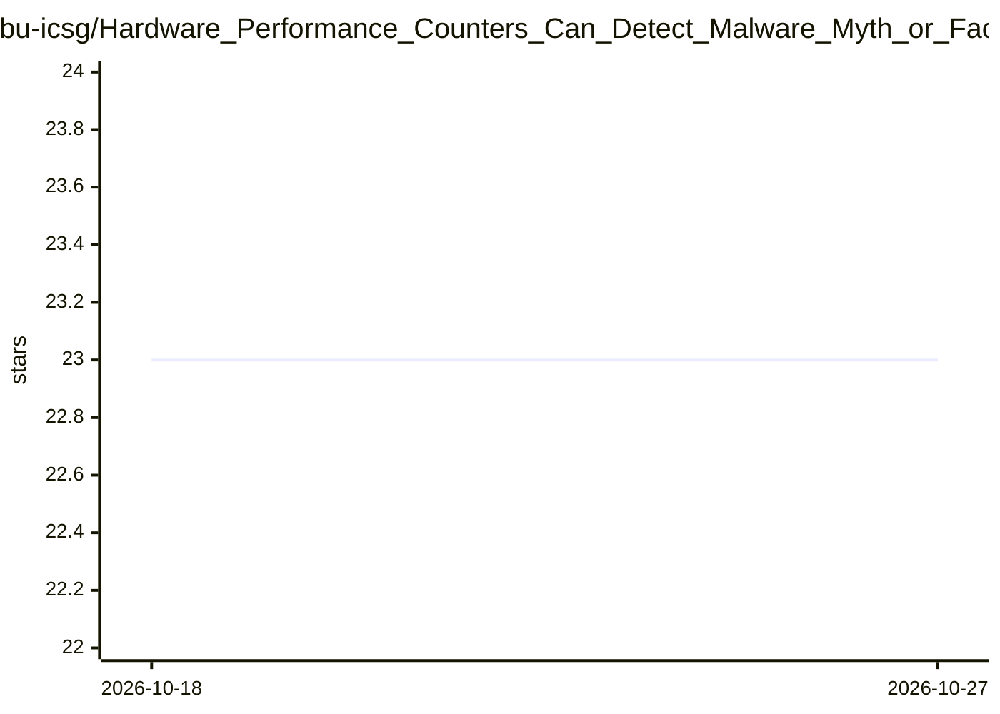

# bu-icsg/Hardware_Performance_Counters_Can_Detect_Malware_Myth_or_Fact

⭐ 23 · C++ · MIT · 推送 2026-02-20 · [GitHub](https://github.com/bu-icsg/Hardware_Performance_Counters_Can_Detect_Malware_Myth_or_Fact) · 组织维护

**AsiaCCS 2018 论文的代码与数据：HPC 恶意软件检测评估**

收录 2018 年 AsiaCCS 最佳论文《Hardware Performance Counters Can Detect Malware: Myth or Fact?》的实验代码与数据，含论文 PDF 与演示幻灯片链接。仓库按目录组织：data_analysis 负责对采样后的硬件性能计数器（HPC）数据进行处理分析，experiment_setup 提供在目标程序上采样 HPC 的实验环境配置。面向希望复现论文实验的安全与体系结构方向科研人员。

## 筛选速览

| 维度 | 判定 | 备注 |
|---|---|---|
| AI 角色 | `ai-native` | 本体是模型或模型工具 |
| 许可风险 | `permissive` | MIT |
| 部署形态 | `None` |  |
| 模型依赖 | — | README 未给出锁定关系 |
| 硬件要求 | — | 无带数字的原话,不猜 |
| 安装摩擦 | `low` | 无编译、无系统依赖或容器化 |
| 成熟度 | — | 结构信号不足 |

## 能力要点

- 论文实验代码、数据与实验环境说明的集合
- data_analysis 目录用于 HPC 采样后的数据处理
- experiment_setup 目录提供目标程序的 HPC 采样配置

## 适用场景

- 复现论文中的 HPC 恶意软件检测实验
- 获取论文引用所需的 bibtex 与 PDF/幻灯片链接

## 场景标签

`网络安全` `科研工具` · 领域:学习与行业

## 证据(README 行号)

> L2: This repository contains data, codes, explanations of experimental setups for
> L31: |-- data_analysis       # data processing after sampling HPCs
> L32: |-- experiment_setup    # experimental setups for sampling HPC on target programs

## 星数曲线

2026-10-18 23 → 2026-10-27 23（+0）

---
*卡片 v1 · prompt 1.4 · 生成 2026-10-27 · 置信度 mid · 依据 README sha `476e5388c51e` · [字段定义](../../DATASET.md)*
