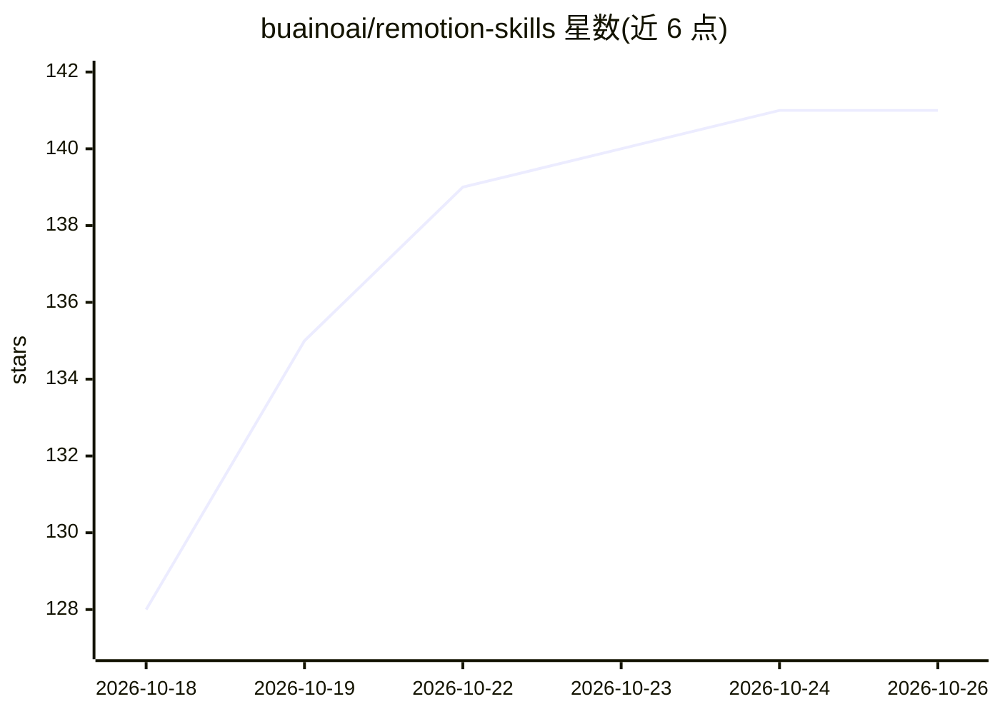

# buainoai/remotion-skills

⭐ 141 · TypeScript · 推送 2026-01-30 · [GitHub](https://github.com/buainoai/remotion-skills) · 个人维护 · 中文 README

**面向 AI 代理的 Remotion 视频开发技能与最佳实践库**

基于原始 remotion-dev/skills 仓库创建的技能库，为 AI 代理提供使用 React 框架 Remotion 进行视频创作的指南与代码示例。内容按动画、时序控制、图像/视频/音频/GIF 媒体处理、3D（Three.js/React Three Fiber）、字幕（含 .srt 导入与音频转录）、字体排版、视频处理工具（Mediabunny）、参数化与优化等主题组织。每个规则文件包含概念说明、代码示例与最佳实践，也可作为开发者的参考资料。

## 筛选速览

| 维度 | 判定 | 备注 |
|---|---|---|
| AI 角色 | `ai-knowledge` | 知识聚合/清单类 |
| 许可风险 | `none` | — |
| 部署形态 | `None` |  |
| 模型依赖 | — | README 未给出锁定关系 |
| 硬件要求 | — | 无带数字的原话,不猜 |
| 安装摩擦 | `low` | 无编译、无系统依赖或容器化 |
| 成熟度 | — | 结构信号不足 |

## 能力要点

- 覆盖动画、媒体处理、3D、字幕、排版、视频工具等 Remotion 开发主题
- 每个规则文件含概念说明、代码示例与最佳实践
- 基于原始 remotion-dev/skills 仓库创建，遵循相同开源许可证

## 适用场景

- 为 AI 代理提供 Remotion 视频开发的知识参考
- 开发者查阅 Remotion 各功能的用法与代码示例
- 了解 Remotion 字幕、3D、参数化等进阶模式

## 场景标签

`提示工程` · 领域:Agent 开发

## 证据(README 行号)

> L3: 这是一个为 AI 代理提供的 Remotion 最佳实践技能库,包含了使用 Remotion 进行视频创作的详细指南和代码示例。
> L58: 这个技能库是为 AI 代理设计的,但也可以作为开发者的参考资料。每个规则文件都包含:

## 星数曲线

2026-10-18 128 → 2026-10-26 141（+13）

---
*卡片 v1 · prompt 1.4 · 生成 2026-10-22 · 置信度 high · 依据 README sha `218d1403193e` · [字段定义](../../DATASET.md)*
