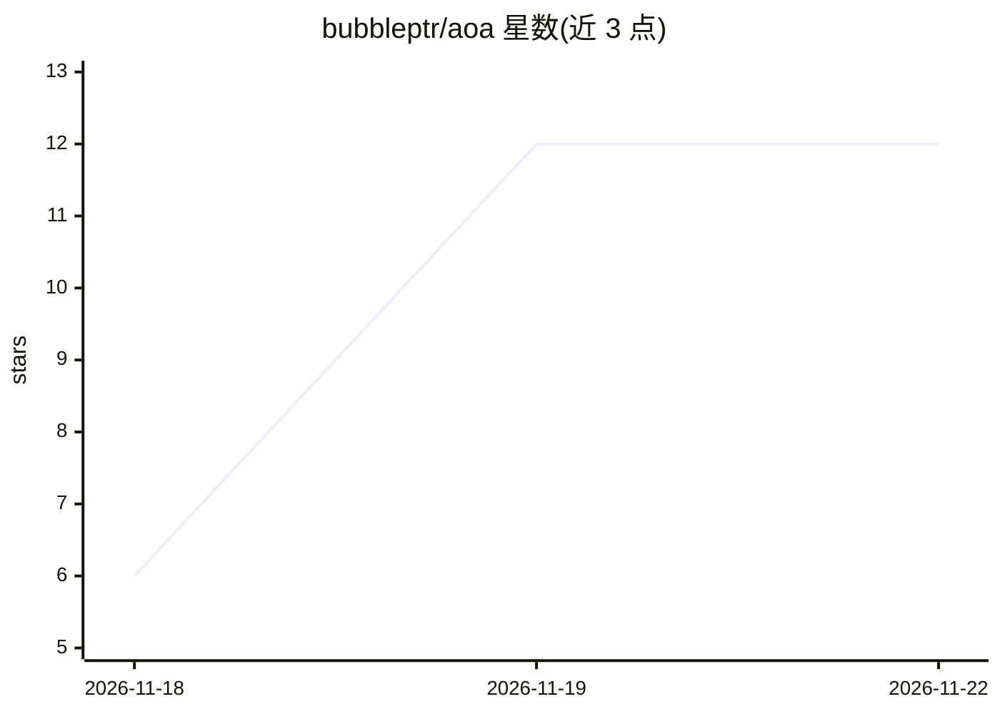

# bubbleptr/aoa

⭐ 12 · TypeScript · MIT · 推送 2026-11-18 · [GitHub](https://github.com/bubbleptr/aoa) · 个人维护 · 中文 README

**基于 Bun 的 Always-on Agent 框架 SDK，24x7 常驻运行**

在 Bun 上构建常驻 Agent 的 SDK：事件进 durable inbox，Worker 认领事件开 run 交给模型 runtime，工具调用按 policy 规则与风险等级裁决，高风险调用延后等人审批；状态全部落在单个 SQLite 文件，进程被杀后可从 inbox 恢复继续执行，并有防重复执行与死信重试机制。支持多 agent 通过 send_to 互发事件协作，内置 pi runtime 与零依赖 loop runtime，外部 harness（Codex、dsh）经适配器接入。附 `aoa` 命令行 coding agent 应用。0.x 期间接口可能有破坏性改动。

## 筛选速览

| 维度 | 判定 | 备注 |
|---|---|---|
| AI 角色 | `ai-ecosystem` | LLM/agent 周边工具 |
| 许可风险 | `permissive` | MIT |
| 部署形态 | `None` |  |
| 模型依赖 | — | README 未给出锁定关系 |
| 硬件要求 | — | 无带数字的原话,不猜 |
| 安装摩擦 | `low` | 无编译、无系统依赖或容器化 |
| 成熟度 | `idea` | |

## 能力要点

- Inbox + Worker 模式，进程被杀后未处理事件可重新取回执行
- 工具调用权限裁决：规则、风险分级、分类器，高风险延后等人审批
- 重跑不重复执行工具，事件与消息按来源去重
- 规范 §9 的 C1–C20 一致性测试带故障注入点

## 适用场景

- 搭建需要 7x24 常驻、定时唤醒的后台 agent
- 让写代码 agent 的高危操作先经人工审批再执行
- 多个 agent 通过互发消息协作完成任务

## 场景标签

`Agent 框架` `多智能体` `编码 Agent` · 领域:Agent 开发

## 证据(README 行号)

> L11: 在 Bun 上搭 Always-on Agent 的 SDK。agent 按 Inbox + Worker 模式 24x7 运行：事件进 inbox，worker 开 run 交给模型，危险的工具调用停下来等人批准，进程随时被杀也
> L80: - **第一档（内核管每次工具调用）**：`@aoa-dev/sdk/pi` 内置 pi 的多模型接入与会话管理（见 `examples/tui`）；不想装 pi 时，`@aoa-dev/sdk/loop` 零第三方依赖，传一个 

## 星数曲线

2026-11-18 6 → 2026-11-22 12（+6）

---
*卡片 v1 · prompt 1.4 · 生成 2026-11-19 · 置信度 high · 依据 README sha `78973e3e4a0c` · [字段定义](../../DATASET.md)*
