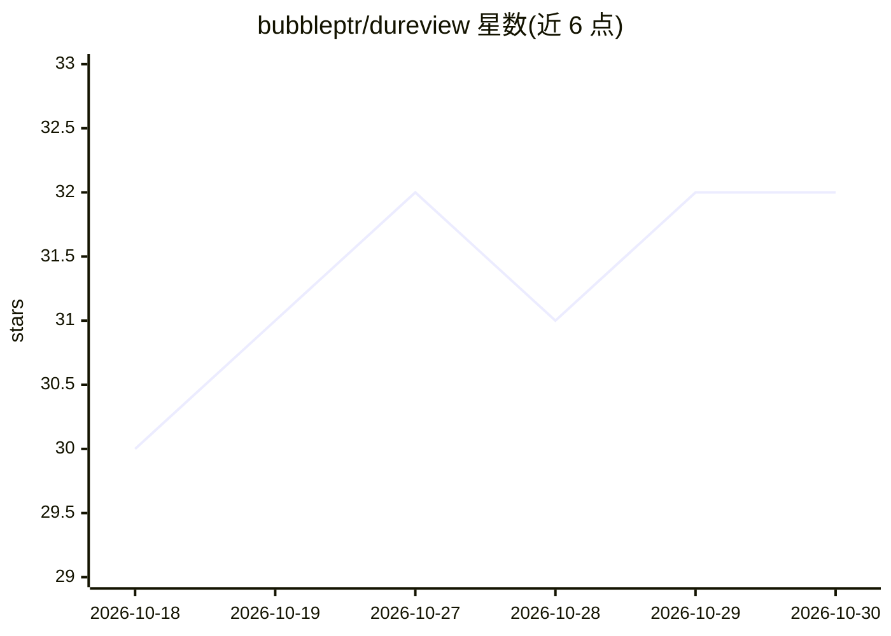

# bubbleptr/dureview

⭐ 32 · TypeScript · MIT · 推送 2026-10-29 · [GitHub](https://github.com/bubbleptr/dureview) · 个人维护 · 中文 README

**自托管的 AI 代码审查机器人：PR 评论触发 P0–P3 内联发现**

自托管 GitHub Pull Request 审查机器人，用 Node.js 22.19+ 编写，运行于 Pi Durable 单进程之上。在 PR 上评论 /dureview 即审查当前 head，输出带优先级（P0–P3）、类型与置信度的内联评论，并创建同名 check run，P0/P1 会提交 Request changes。支持通过 ChatGPT 订阅登录或 API key 调用模型，可选 openai、openrouter、deepseek、GitHub Copilot、xAI 等多个 provider。提供 Docker/Compose/npm 安装方式，审查状态存 SQLite，崩溃后可恢复。仓库根目录 .dureview.md 可配置触发方式、阈值与提示词。

## 筛选速览

| 维度 | 判定 | 备注 |
|---|---|---|
| AI 角色 | `ai-native` | 本体是模型或模型工具 |
| 许可风险 | `permissive` | MIT |
| 部署形态 | `self-host` | docker 或自建部署 |
| 模型依赖 | locked-api |  |
| 硬件要求 | — | 无带数字的原话,不猜 |
| 安装摩擦 | `low` | 无编译、无系统依赖或容器化 |
| 成熟度 | — | 结构信号不足 |

## 能力要点

- PR 评论触发，输出 P0–P3 优先级、类型与置信度的内联发现及 check run
- 支持 ChatGPT 订阅登录或 API key，多 provider 可选（openai/openrouter/deepseek 等）
- Pi Durable 单进程运行，SQLite 保存审查历史，崩溃后恢复
- .dureview.md 配置触发方式、置信度阈值、忽略 glob 与提示词

## 适用场景

- 团队自托管 AI 代码审查，通过 check run 阻断 P0/P1 问题
- 用自己的 ChatGPT 订阅或 API key 运行审查，控制成本
- 在分支保护中将 dureview 设为必需状态检查

## 场景标签

`代码审查` · 领域:编码与开发

## 证据(README 行号)

> L5: Self-hosted pull request review bot. Comment `/dureview` on a pull request and it posts P0–P3 inline findings plus a
> L9: > **ChatGPT subscription use is at your own risk.** The Codex login signs in with a ChatGPT Plus/Pro subscription (t

## 星数曲线

2026-10-18 30 → 2026-10-30 32（+2）

---
*卡片 v1 · prompt 1.4 · 生成 2026-10-26 · 置信度 high · 依据 README sha `b38685fb5c0a` · [字段定义](../../DATASET.md)*
