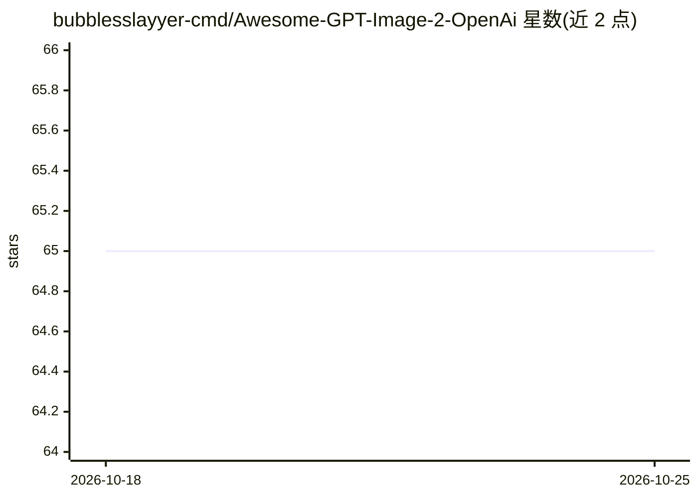

# bubblesslayyer-cmd/Awesome-GPT-Image-2-OpenAi

⭐ 65 · TypeScript · MIT · 推送 2026-04-23 · [GitHub](https://github.com/bubblesslayyer-cmd/Awesome-GPT-Image-2-OpenAi) · 个人维护

**面向 OpenAI GPT Image 2 的提示词合集，覆盖角色/设计/艺术类提示**

一个针对 OpenAI GPT Image 2 图像生成模型的提示词库：按角色与人像、设计与营销、艺术与美学三大类组织提示词，覆盖虚拟人设、UI 样机、电商图、电影感画面等场景；README 列出该模型在文字渲染、角色一致性、结构化设计与风格还原四方面的提示方向。部分提示兼容 Raycast Snippets，使用 {argument} 占位符替换主体、颜色或文字。以 zip 文件下载与 PR 贡献方式提供，许可为 CC BY 4.0，自述用于教育与创作用途。

## 筛选速览

| 维度 | 判定 | 备注 |
|---|---|---|
| AI 角色 | `ai-knowledge` | 知识聚合/清单类 |
| 许可风险 | `permissive` | MIT |
| 部署形态 | `None` |  |
| 模型依赖 | — | README 未给出锁定关系 |
| 硬件要求 | — | 无带数字的原话,不猜 |
| 安装摩擦 | `low` | 无编译、无系统依赖或容器化 |
| 成熟度 | — | 结构信号不足 |

## 能力要点

- 按角色人像/设计营销/艺术美学三大类组织的提示词导航
- 部分提示兼容 Raycast Snippets，支持 {argument} 动态占位符替换
- 通过 fork + PR 方式接受社区提示词贡献

## 适用场景

- 创作者为 GPT Image 2 查找角色一致性与文字排版类提示词
- 设计与营销场景直接复用 UI 样机、产品海报提示
- 在 Raycast 中配置可替换参数的图像生成快捷片段

## 场景标签

`图像生成` · 领域:内容生成

## 证据(README 行号)

> L10: Welcome to the **Awesome GPT Image 2** library. This is a high-signal collection of prompts specifically engineered
> L27: ## 🗺 Prompt Navigation

## 星数曲线

2026-10-18 65 → 2026-10-25 65（+0）

---
*卡片 v1 · prompt 1.4 · 生成 2026-10-24 · 置信度 mid · 依据 README sha `ed898ba176ef` · [字段定义](../../DATASET.md)*
