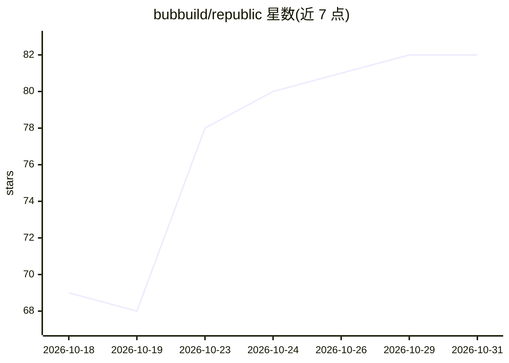

# bubbuild/republic

⭐ 82 · Python · Apache-2.0 · 推送 2026-10-30 · [GitHub](https://github.com/bubbuild/republic) · [官网](https://getrepublic.org) · 组织维护

**跨 AI 提供商的统一 Python SDK：聊天/流式/工具调用/结构化输出**

面向开发者的 Python 库，将多个 AI 提供商的聊天、流式、工具调用与结构化输出封装为一个统一接口。模型以 `provider:model` 形式命名（如 anthropic、google、deepseek），各服务从 `REPUBLIC_<PROVIDER>_API_KEY` 环境变量读取密钥，切换服务只需改名。边界明确：不提供 agent 循环、工具执行与网关，这些留在用户代码中。支持媒体输入、嵌入、图像生成、自定义提供商及可选的 Extension 扩展接口。需 Python 3.11+，Apache 2.0 许可。

## 筛选速览

| 维度 | 判定 | 备注 |
|---|---|---|
| AI 角色 | `ai-ecosystem` | LLM/agent 周边工具 |
| 许可风险 | `permissive` | Apache-2.0 |
| 部署形态 | `library` | 以包/库形式分发 |
| 模型依赖 | — | README 未给出锁定关系 |
| 硬件要求 | — | 无带数字的原话,不猜 |
| 安装摩擦 | `low` | 无编译、无系统依赖或容器化 |
| 成熟度 | — | 结构信号不足 |

## 能力要点

- 统一接口覆盖多家提供商的聊天/流式/工具调用/结构化输出
- `provider:model` 命名切换服务，密钥按提供商环境变量读取
- 支持媒体输入、嵌入、图像生成、自定义提供商
- 可选 Extension 接口观测调用结果与重试

## 适用场景

- 在多 AI 提供商间切换而无需改写接口代码
- 构建自己的 agent 循环与工具执行时复用统一调用层
- 通过结构化输出接口获取可解析的模型结果

## 场景标签

`模型网关` · 领域:Agent 开发

## 证据(README 行号)

> L3: One Python interface for chat, streaming, tool calls, and structured output across AI providers. Republic stops at p
> L21: A model is named `provider:model`. Switch services by changing the name, such as `anthropic:MODEL_ID`, `google:MODE

## 星数曲线

2026-10-18 69 → 2026-10-31 82（+13）

---
*卡片 v1 · prompt 1.4 · 生成 2026-10-24 · 置信度 high · 依据 README sha `f06c80932919` · [字段定义](../../DATASET.md)*
