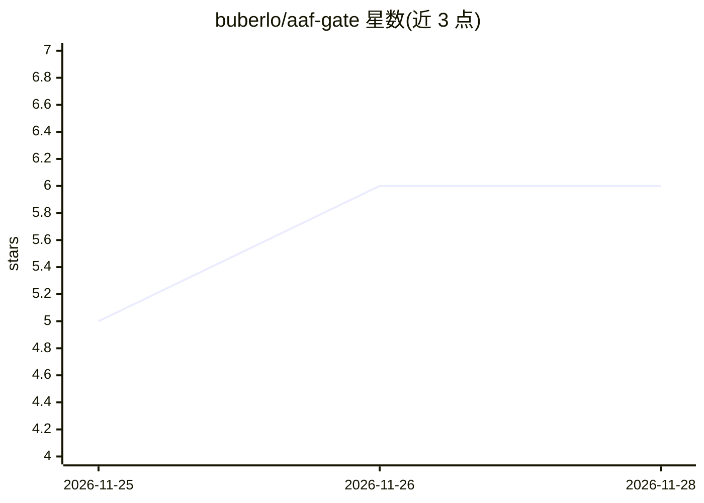

# buberlo/aaf-gate

⭐ 6 · Python · Apache-2.0 · 推送 2026-11-23 · [GitHub](https://github.com/buberlo/aaf-gate) · 个人维护

**为 AI agent 运行时提供确定性策略门控与审计的组件**

aaf-gate 是部署在既有 AI agent 运行时（主要为 Hermes Agent，锁定 v0.23.1）之前的确定性策略门：按工具类（read/draft/internal_write）对工具调用做允许或拒绝决策，提供 kill switch、按时间窗口的调用次数限制、SQLite 中哈希链式 append-only 审计日志，以及带链锚点的备份恢复和 Mac mini 设备验收包。核心仅用 Python 标准库实现，无第三方依赖。状态为 v1 候选（1.0.0rc1），本地完成单元测试（719 项），未做生产就绪与合规声明；项目当前无活跃维护者。

## 筛选速览

| 维度 | 判定 | 备注 |
|---|---|---|
| AI 角色 | `ai-ecosystem` | LLM/agent 周边工具 |
| 许可风险 | `permissive` | Apache-2.0 |
| 部署形态 | `None` |  |
| 模型依赖 | — | README 未给出锁定关系 |
| 硬件要求 | — | 无带数字的原话,不猜 |
| 安装摩擦 | `low` | 无编译、无系统依赖或容器化 |
| 成熟度 | `idea` | |

## 能力要点

- 按工具类（read/draft/internal_write）的确定性策略决策
- kill switch（gate-stop/gate-resume/gate-status）与按时间窗口的调用次数限制
- SQLite 中哈希链式 append-only 审计日志与链锚点备份恢复
- core/ 仅用 Python 标准库，无第三方 Python 依赖

## 适用场景

- 为 Hermes Agent 的工具调用加策略门控与调用限额
- 为 agent 运行保留防篡改审计日志
- 需要一键停止某个 principal 的 agent 工作时使用 kill switch

## 场景标签

`Agent 框架` · 领域:Agent 开发

## 证据(README 行号)

> L7: Deterministic policy gate, kill switch, call limits and tamper-evident audit for existing AI agent runtimes. **Not a
> L13: aaf-gate sits in front of tool calls and applies a deterministic policy per tool class:

## 星数曲线

2026-11-25 5 → 2026-11-28 6（+1）

---
*卡片 v1 · prompt 1.4 · 生成 2026-11-24 · 置信度 high · 依据 README sha `ceffe49fab82` · [字段定义](../../DATASET.md)*
