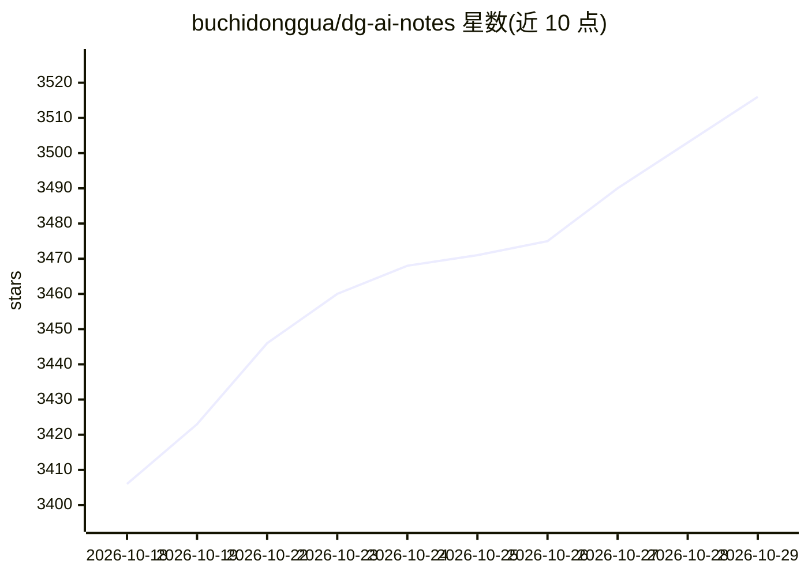

# buchidonggua/dg-ai-notes

⭐ 3,516 · MDX · MIT · 推送 2026-08-23 · [GitHub](https://github.com/buchidonggua/dg-ai-notes) · [官网](https://dg-ai-notes.pages.dev/) · 个人维护 · 中文 README

**Pi-Agent 源码解读与二次开发实战教程（电子书+skill）**

围绕开源 Agent SDK Pi-Agent（OpenClaw 的底层框架）编写的双轨学习教程：一是 10 章源码精读，从三层架构、Agent Loop 讲到上下文工程与会话管理，TypeScript 与 Python 双版本对照，配 30+ 配图和可单步运行的 Agent Loop 实验场；二是 7 章实战，以企业数据分析助手 DataAgent 为例从零搭到可部署，配 7 组 npm 可跑代码；三是 dg-piagent skill，装入 Claude Code / ZCode / Codex / pi 等智能体后供 AI 查用。提供 Web 在线版、Markdown 与 PDF 三种阅读方式，配套 B 站讲解视频。

## 筛选速览

| 维度 | 判定 | 备注 |
|---|---|---|
| AI 角色 | `ai-knowledge` | 知识聚合/清单类 |
| 许可风险 | `permissive` | MIT |
| 部署形态 | `library` | 以包/库形式分发 |
| 模型依赖 | — | README 未给出锁定关系 |
| 硬件要求 | — | 无带数字的原话,不猜 |
| 安装摩擦 | `low` | 无编译、无系统依赖或容器化 |
| 成熟度 | — | 结构信号不足 |

## 能力要点

- 10 章源码解读，TS/Python 双版本对照，配 Agent Loop 实验场
- 7 章实战教程搭建可部署的 DataAgent，附 7 组 npm 即跑代码
- dg-piagent skill 可装入 Claude Code / ZCode / Codex / pi 使用
- Web 在线 / Markdown / PDF 三种阅读方式

## 适用场景

- 系统学习一个生产级 Agent SDK 的源码设计与取舍
- 跟着教程从零搭建并部署一个垂直 Agent
- 把 dg-piagent skill 装进智能体辅助 pi-agent 开发

## 场景标签

`教程课程` · 领域:学习与行业

## 证据(README 行号)

> L1: > Pi源码解读和二次开发实战
> L15: ### 🔬 源码解读 · 10 章拆完一个生产级 SDK
> L21: ### 🚀 实战案例 · 7 章搭一个能上线的 Agent

## 星数曲线

2026-10-18 3,406 → 2026-10-29 3,516（+110）

---
*卡片 v1 · prompt 1.4 · 生成 2026-10-20 · 置信度 mid · 依据 README sha `432b2f65b418` · [字段定义](../../DATASET.md)*
