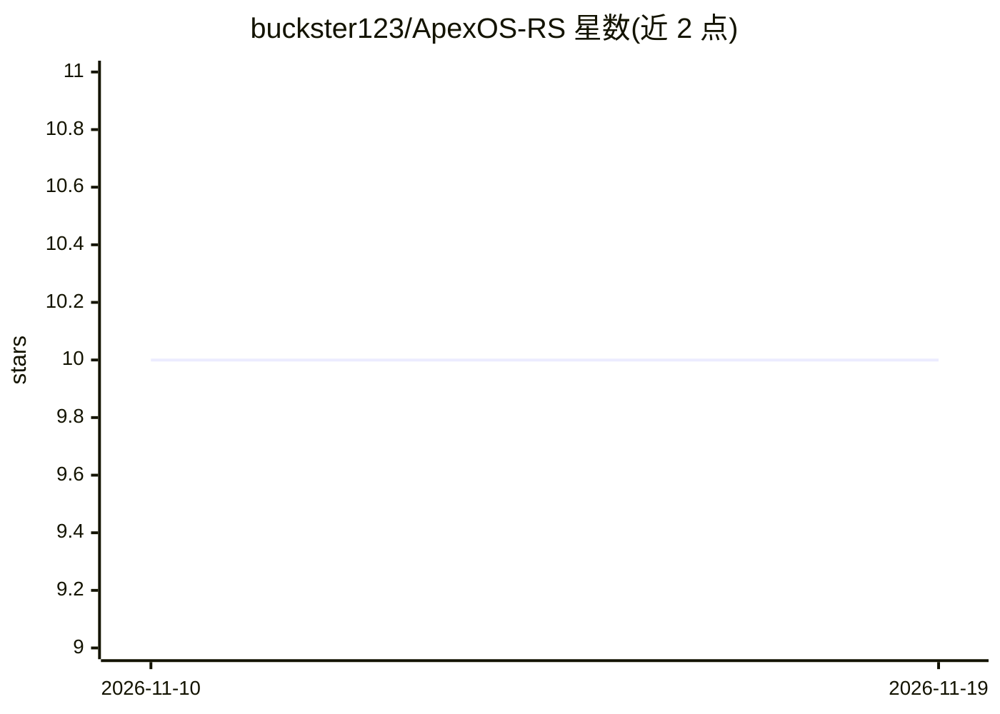

# buckster123/ApexOS-RS

⭐ 10 · Rust · NOASSERTION · 推送 2026-08-22 · [GitHub](https://github.com/buckster123/ApexOS-RS) · 个人维护

**跑在自有单板机上的本地 AI agent 系统，可自我改写代码**

以纯 Rust Cargo workspace 实现的 self-contained agent 系统，包含 agent 守护进程、Cerebro 认知记忆系统（FTS5 + 可选语义嵌入）、系统/传感器/视觉工具与原生 GPU 渲染 UI。支持从 Pi Zero 到 DGX 的硬件分级，可完全离线用本地模型运行或调用 API。关键机制包括：自我更新循环（agent 提交源码、隔离构建、root watchdog 健康检查与自动回滚）、可逆的自我演化（soul/policy/plugins）、多节点 colony 联邦（mDNS 发现、记忆交换）、本地语音（Kokoro TTS + Whisper STT）。通过 install.sh 或 cargo build 安装。

## 筛选速览

| 维度 | 判定 | 备注 |
|---|---|---|
| AI 角色 | `ai-native` | 本体是模型或模型工具 |
| 许可风险 | `none` | NOASSERTION |
| 部署形态 | `None` |  |
| 模型依赖 | local-ok | 支持本地模型 |
| 硬件要求 | — | 无带数字的原话,不猜 |
| 安装摩擦 | `high` | 编译与系统依赖俱全 |
| 成熟度 | `idea` | |

## 能力要点

- 守护进程可重建并热替换自身二进制，watchdog 健康检查失败自动回滚
- Cerebro 记忆系统支持跨重启记忆、夜间空闲整合与梦境摘要
- 本地语音：Kokoro-82M TTS + Whisper STT，云语音可选
- 多节点 colony：mDNS 发现、agent 间消息、记忆联邦与 GPU 节点共享推理

## 适用场景

- 在闲置单板机上搭建持久化、可离线运行的 AI agent
- 多个节点组成集群共享推理与记忆
- 研究 agent 自我改写与安全回滚机制

## 场景标签

`AI 助手` `Agent 记忆` · 领域:Agent 开发

## 证据(README 行号)

> L22: ApexOS-RS is a **self-contained AI agent operating system** — the agent daemon, a cognitive memory system, system/s
> L18: > **What if your AI assistant wasn't a chat window to someone else's datacenter — but a *resident* of a $150 comput

## 星数曲线

2026-11-10 10 → 2026-11-19 10（+0）

---
*卡片 v1 · prompt 1.4 · 生成 2026-11-19 · 置信度 high · 依据 README sha `239fa81821b4` · [字段定义](../../DATASET.md)*
