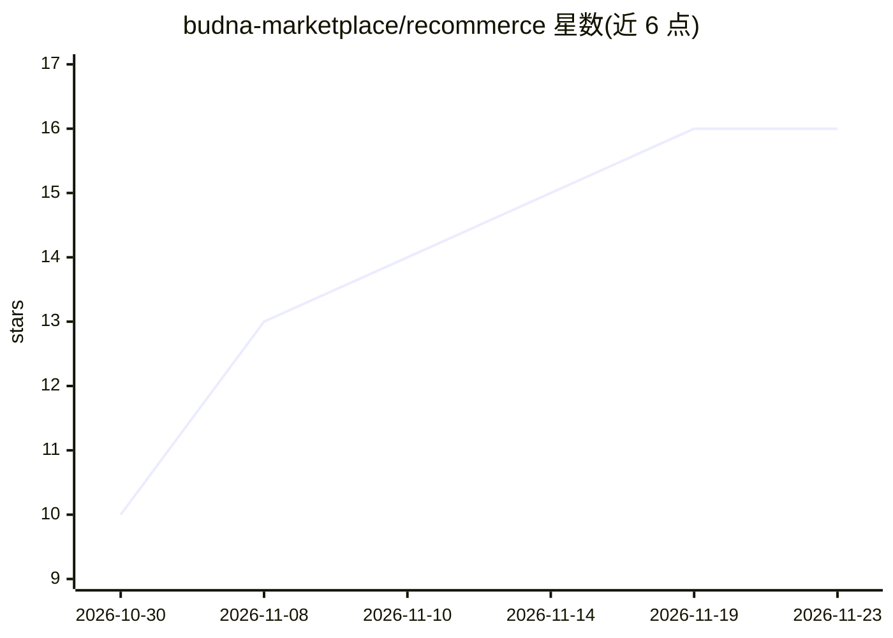

# budna-marketplace/recommerce

⭐ 16 · TypeScript · MIT · 推送 2026-11-09 · [GitHub](https://github.com/budna-marketplace/recommerce) · 组织维护

**二手与新品比价采购的便携 agent 技能包（6 个技能）**

Budna 维护的 Agent Skills 集合，覆盖新品与二手市场商品的发现比较（Buy）、多件组装（Kits）、购前检查（Inspect）、取货规划（Collect）、维修与替换决策（Keep）与建议复核（Second Look）。每个技能独立工作，输出区分卖家声明、文档支持与待核验内容；提供只读工具取证据，Budna MCP 为可选集成。技能不联系卖家、不下单、不认证物品状况。通过 npx skills CLI 安装，可按技能选择并指定兼容的 agent 宿主。

## 筛选速览

| 维度 | 判定 | 备注 |
|---|---|---|
| AI 角色 | `ai-knowledge` | 知识聚合/清单类 |
| 许可风险 | `permissive` | MIT |
| 部署形态 | `library` | 以包/库形式分发 |
| 模型依赖 | — | README 未给出锁定关系 |
| 硬件要求 | — | 无带数字的原话,不猜 |
| 安装摩擦 | `low` | 无编译、无系统依赖或容器化 |
| 成熟度 | — | 结构信号不足 |

## 能力要点

- 6 个独立技能覆盖比价、组装、检查、取货、维修决策与复核
- 输出区分卖家声明、文档支持与未核验事项
- 含合成回归用例与离线评估工作流（Recommerce Checks）
- 技能与交易分离：不联系卖家、不竞价、不购买

## 适用场景

- 比较二手与新品listing并生成有依据的候选清单
- 购买前生成针对具体listing的检查卡片
- 决定维修、升级还是替换现有物品
- 评估自行取货的可行性与总成本

## 场景标签

 · 领域:消费/再 commerce 决策工具

## 证据(README 行号)

> L3: **Agent skills for comparing new and pre-owned items.**
> L20: Each skill works independently with evidence the host can access: listings, specifications, measurements, quotes, o
> L84: These are general decision workflows; examples rely on supplied or verified specifications and quotes. No workflow 

## 星数曲线

2026-10-30 10 → 2026-11-23 16（+6）

---
*卡片 v1 · prompt 1.4 · 生成 2026-11-18 · 置信度 mid · 依据 README sha `b7735c2bcbb6` · [字段定义](../../DATASET.md)*
