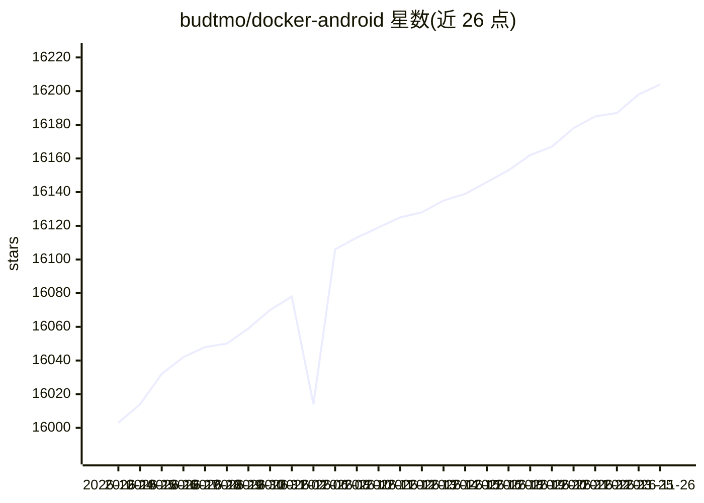

# budtmo/docker-android

⭐ 16,204 · Python · NOASSERTION · 推送 2026-11-25 · [GitHub](https://github.com/budtmo/docker-android) · 个人维护

**Docker 内运行 Android 模拟器：开发测试、VNC 观看与 MCP/AI-Agent 控制**

将 Android 模拟器打包为 Docker 镜像，覆盖 Android 11–14（另有 Genymotion 与 MCP 镜像变体），提供多种真机设备 profile 与皮肤、noVNC 网页查看容器内部、日志 web-UI 共享、adb connect 外部控制、构建 Android 工程及 Appium/Espresso 单元与 UI 测试。以 docker run 一条命令启动，要求宿主机支持虚拟化（/dev/kvm），支持 NVIDIA GPU 渲染与 WSL2 硬件加速。含 beta 版 docker-android MCP-Server、Appium MCP 与 AI-Agent；AI-Agent 仅在赞助制的 Pro 版镜像中提供，支持 Ollama、VLLM 本地 LLM 服务器。

## 筛选速览

| 维度 | 判定 | 备注 |
|---|---|---|
| AI 角色 | `ai-enhanced` | 去掉 AI 部分产品仍成立 |
| 许可风险 | `none` | NOASSERTION |
| 部署形态 | `self-host` | docker 或自建部署 |
| 模型依赖 | local-ok | 支持本地模型 |
| 硬件要求 | — | 无带数字的原话,不猜 |
| 安装摩擦 | `low` | 无编译、无系统依赖或容器化 |
| 成熟度 | — | 结构信号不足 |

## 动量与使用信号

- 维护:`active` — 距上次 push 3.4 天,年发版 10,54 位贡献者
- 涨星:近 1 天 **+8**(自 20261016 起算)
- 安装:github 包 `release-assets` 月下载无数据
- 平台:WINDOWS / ANDROID · 协议:MCP / OLLAMA

## 能力要点

- docker run 一条命令启动 Android 模拟器，noVNC 网页查看
- 多种设备 profile（Samsung/Nexus/Pixel）与 Android 11–14 镜像
- beta 版 docker-android MCP-Server、Appium MCP 与 AI-Agent（Pro 版）
- 支持 NVIDIA GPU 渲染、WSL2 嵌套虚拟化、数据卷持久化

## 适用场景

- 在 CI（Jenkins）中运行 Android UI 测试
- 本地开发时通过网页 VNC 查看和控制模拟器
- 在 Azure/AWS/GCP 云上部署 Android 模拟器
- 用 AI-Agent 通过本地 LLM 控制模拟器（Pro 版）

## 场景标签

`GUI 自动化` · 领域:效率与自动化

## 证据(README 行号)

> L3: Docker-Android is a docker image built to be used for everything related to Android. It can be used for Application 
> L27: 8. It support (http) docker-android MCP-Server (beta-version)
> L29: 10. It support AI-Agent (beta-version) - supported local-LLM server: Ollama, VLLM

## 星数曲线

2026-10-24 16,003 → 2026-11-26 16,204（+201）

---
*卡片 v1 · prompt 1.4 · 生成 2026-11-26 · 置信度 high · 依据 README sha `39ed5957ff7a` · [字段定义](../../DATASET.md)*
