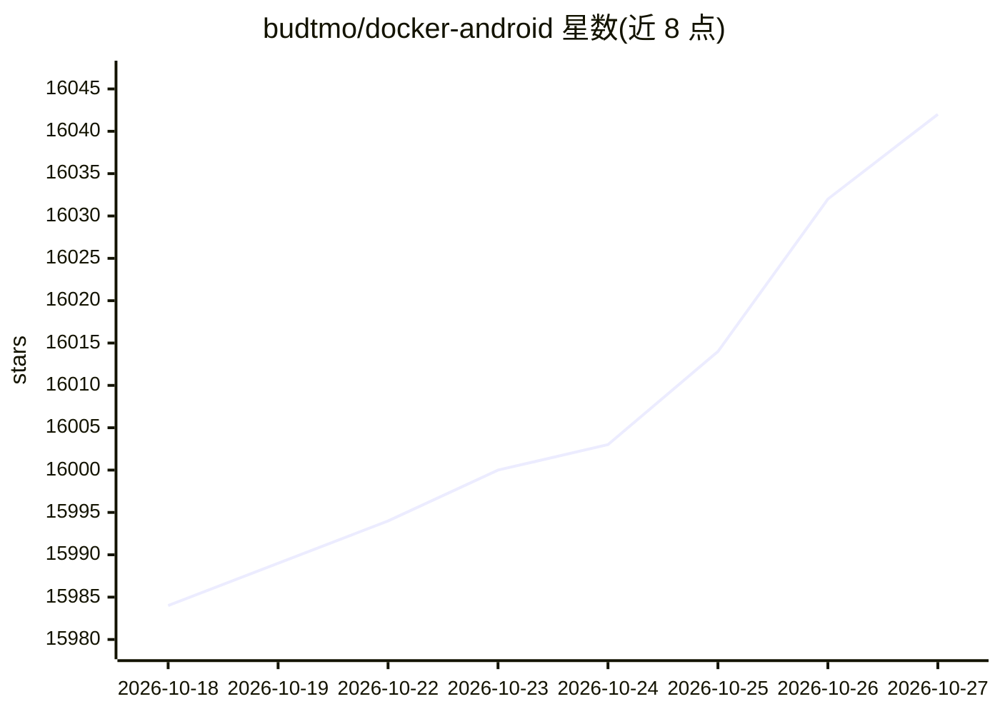

# budtmo/docker-android

⭐ 16,042 · Python · NOASSERTION · 推送 2026-10-26 · [GitHub](https://github.com/budtmo/docker-android) · 个人维护

**在 Docker 中运行 Android 模拟器的镜像，供开发测试与 AI-Agent 场景**

提供封装 Android 模拟器的 Docker 镜像，覆盖 9.0–14.0 多个 Android 版本与多种手机/平板设备配置。功能包括：noVNC 网页查看容器内部、日志 Web-UI 共享、adb connect 从容器外控制模拟器、运行 Appium/Espresso 等测试框架构建 Android 项目。含 beta 版 MCP-Server 与 AI-Agent 支持（AI-Agent 属 pro 版），支持对接 Genymotion 云及 Azure/AWS/GCP 部署。要求宿主机为 Ubuntu 并支持虚拟化（KVM），macOS/Windows 需借助虚拟机或 WSL2。

## 筛选速览

| 维度 | 判定 | 备注 |
|---|---|---|
| AI 角色 | `ai-ecosystem` | LLM/agent 周边工具 |
| 许可风险 | `none` | NOASSERTION |
| 部署形态 | `self-host` | docker 或自建部署 |
| 模型依赖 | local-ok | 支持本地模型 |
| 硬件要求 | — | 无带数字的原话,不猜 |
| 安装摩擦 | `low` | 无编译、无系统依赖或容器化 |
| 成熟度 | — | 结构信号不足 |

## 动量与使用信号

- 维护:`active` — 距上次 push 3.4 天,年发版 10,54 位贡献者
- 涨星:近 1 天 **+8**(自 20261016 起算)
- 安装:github 包 `release-assets` 月下载无数据
- 平台:WINDOWS / ANDROID · 协议:MCP / OLLAMA

## 能力要点

- 多 Android 版本与设备配置的模拟器 Docker 镜像
- noVNC 网页查看与 Web-UI 日志共享
- 支持 adb connect 外部控制与 Appium/Espresso UI 测试
- beta 版 MCP-Server；AI-Agent 支持本地 LLM 服务器 Ollama/VLLM（pro 版）

## 适用场景

- 在容器中构建 Android 项目并运行单元与 UI 测试
- CI（如 Jenkins）中运行 Android 模拟器测试
- 通过网页浏览器查看与操作容器内模拟器
- 在云端部署 Android 模拟器环境

## 场景标签

`GUI 自动化` · 领域:效率与自动化

## 证据(README 行号)

> L3: Docker-Android is a docker image built to be used for everything related to Android. It can be used for Application 
> L13: 8. It support (http) MCP-Server (beta-version)
> L14: 9. It support AI-Agent (beta-version) - supported local-LLM server: Ollama, VLLM

## 星数曲线

2026-10-18 15,984 → 2026-10-27 16,042（+58）

---
*卡片 v1 · prompt 1.4 · 生成 2026-10-18 · 置信度 high · 依据 README sha `6b30ca0cb864` · [字段定义](../../DATASET.md)*
