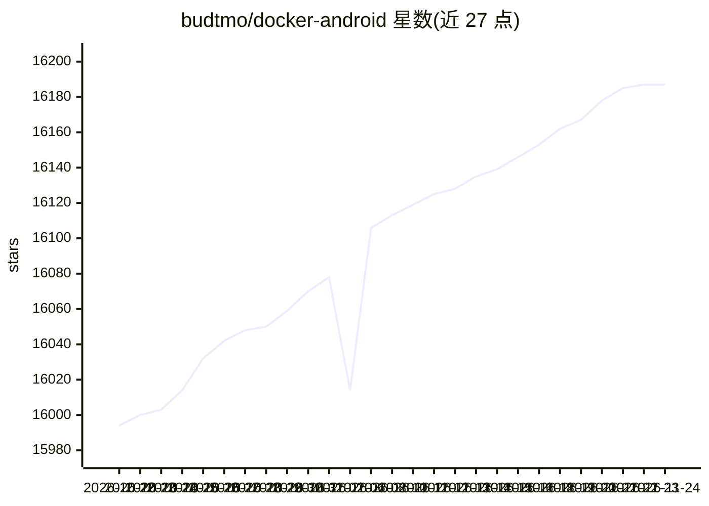

# budtmo/docker-android

⭐ 16,198 · Python · NOASSERTION · 推送 2026-11-24 · [GitHub](https://github.com/budtmo/docker-android) · 个人维护

**Docker 中的 Android 模拟器镜像，供开发测试与云端部署**

将 Android 模拟器封装为 Docker 镜像的方案，提供多种设备型号与 Android 版本（9.0–14.0）的镜像。支持通过 noVNC 在浏览器查看容器内画面、adb connect 从容器外控制模拟器、Web-UI 查看日志、构建 Android 项目、运行 Appium/Espresso 等 UI 测试，并可集成 Genymotion 与部署到 AWS/Azure/GCP。宿主机仅支持 Ubuntu（OSX/Windows 需虚拟机），且需开启硬件虚拟化。另有赞助者可拉取的 Pro 版本，提供 AI-Agent、代理、headless 模式等附加功能。

## 筛选速览

| 维度 | 判定 | 备注 |
|---|---|---|
| AI 角色 | `ai-enhanced` | 去掉 AI 部分产品仍成立 |
| 许可风险 | `none` | NOASSERTION |
| 部署形态 | `self-host` | docker 或自建部署 |
| 模型依赖 | local-ok | 支持本地模型 |
| 硬件要求 | — | 无带数字的原话,不猜 |
| 安装摩擦 | `low` | 无编译、无系统依赖或容器化 |
| 成熟度 | — | 结构信号不足 |

## 动量与使用信号

- 维护:`active` — 距上次 push 3.4 天,年发版 10,54 位贡献者
- 涨星:近 1 天 **+8**(自 20261016 起算)
- 安装:github 包 `release-assets` 月下载无数据
- 平台:WINDOWS / ANDROID · 协议:MCP / OLLAMA

## 能力要点

- 多种设备型号与 Android 版本的 Docker 镜像
- noVNC 浏览器访问与 adb 外部控制模拟器
- 支持 Appium、Espresso 等测试框架与 Jenkins 集成
- 内置 docker-android MCP-Server 与 Appium MCP（beta）

## 适用场景

- 在 CI（如 Jenkins）中运行 Android UI 测试
- 在云端批量部署 Android 模拟器环境
- 开发调试时通过浏览器查看与控制模拟器
- 构建 Android 项目

## 场景标签

 · 领域:开发工具/移动测试

## 证据(README 行号)

> L3: Docker-Android is a docker image built to be used for everything related to Android. It can be used for Application 
> L27: 8. It support (http) docker-android MCP-Server (beta-version)
> L29: 10. It support AI-Agent (beta-version) - supported local-LLM server: Ollama, VLLM

## 星数曲线

2026-10-22 15,994 → 2026-11-24 16,187（+193）

---
*卡片 v1 · prompt 1.4 · 生成 2026-11-23 · 置信度 high · 依据 README sha `29a6d564f9a8` · [字段定义](../../DATASET.md)*
