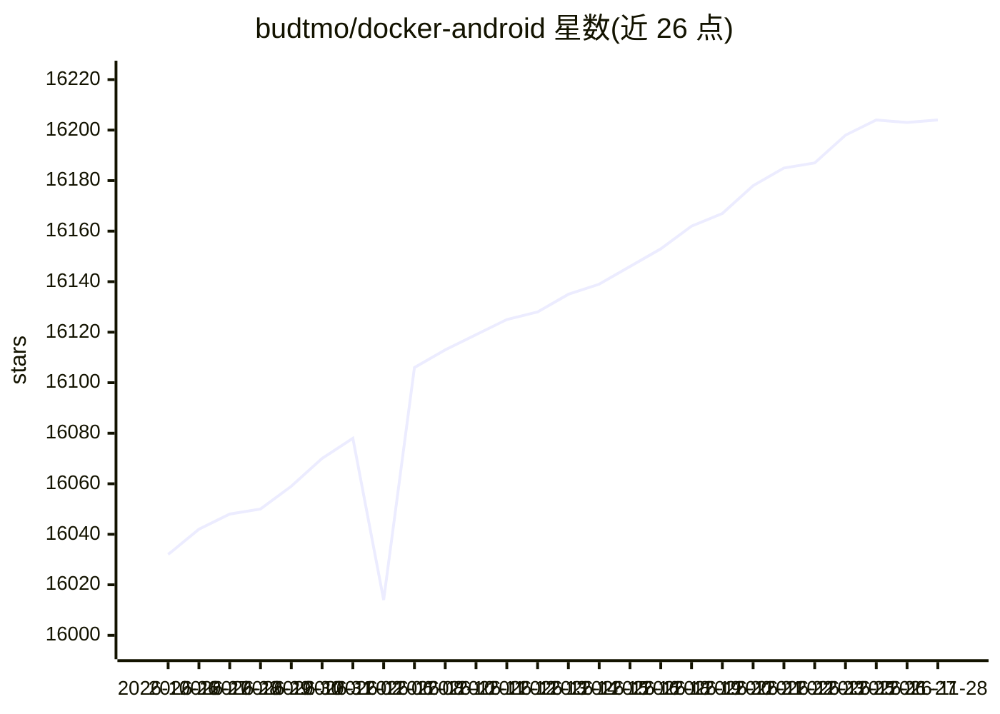

# budtmo/docker-android

⭐ 16,204 · Python · NOASSERTION · 推送 2026-11-27 · [GitHub](https://github.com/budtmo/docker-android) · 个人维护

**供开发者测试运行 Android 应用的 Docker 化模拟器**

提供封装 Android 模拟器的 Docker 镜像，覆盖多种设备型号与 Android 版本，支持 noVNC 网页查看容器内屏幕、日志共享 Web-UI、adb connect 外部控制、构建 Android 项目以及运行 Appium/Espresso 等 UI 测试，并可集成 Genymotion Cloud 与部署到 Azure/AWS/GCP。另含 beta 版 docker-android MCP-Server 与 Appium MCP，AI-Agent 功能（由 Ollama/vLLM 本地 LLM 驱动、自然语言控制模拟器）仅在赞助制的 pro 版本中提供。宿主机要求 Ubuntu 与开启虚拟化（/dev/kvm）。

## 筛选速览

| 维度 | 判定 | 备注 |
|---|---|---|
| AI 角色 | `ai-enhanced` | 去掉 AI 部分产品仍成立 |
| 许可风险 | `none` | NOASSERTION |
| 部署形态 | `self-host` | docker 或自建部署 |
| 模型依赖 | local-ok | 支持本地模型 |
| 硬件要求 | — | 无带数字的原话,不猜 |
| 安装摩擦 | `low` | 无编译、无系统依赖或容器化 |
| 成熟度 | — | 结构信号不足 |

## 动量与使用信号

- 维护:`active` — 距上次 push 3.4 天,年发版 10,54 位贡献者
- 涨星:近 1 天 **+8**(自 20261016 起算)
- 安装:github 包 `release-assets` 月下载无数据
- 平台:WINDOWS / ANDROID · 协议:MCP / OLLAMA

## 能力要点

- Docker 镜像形式提供 Android 11–14 开发/生产级模拟器及多种设备皮肤
- noVNC 网页查看、日志 Web-UI 分享、adb connect 外部控制
- 内置 docker-android MCP-Server（beta）与 Appium MCP
- 支持 NVIDIA GPU 渲染与 WSL2 嵌套虚拟化加速

## 适用场景

- 在 CI（如 Jenkins）中运行 Android UI 自动化测试
- 通过浏览器远程查看和操作容器内的 Android 模拟器
- 在云端批量部署 Android 测试环境
- 用本地 LLM 通过自然语言控制模拟器（pro 版）

## 场景标签

 · 领域:开发/测试工具

## 证据(README 行号)

> L3: Docker-Android is a docker image built to be used for everything related to Android. It can be used for Application 
> L27: 8. It support (http) docker-android MCP-Server (beta-version)
> L29: 10. It support AI-Agent (beta-version) - supported local-LLM server: Ollama, VLLM

## 星数曲线

2026-10-26 16,032 → 2026-11-28 16,204（+172）

---
*卡片 v1 · prompt 1.4 · 生成 2026-11-27 · 置信度 high · 依据 README sha `e6b2e19d582f` · [字段定义](../../DATASET.md)*
