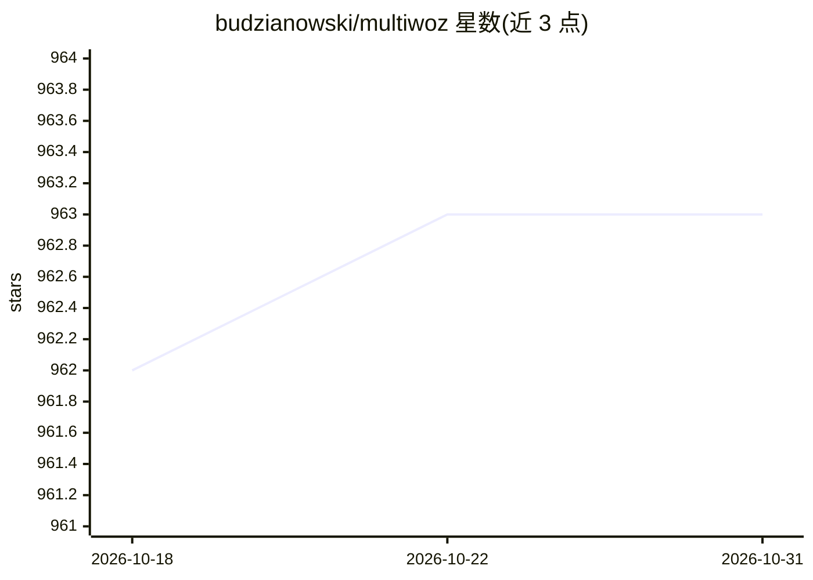

# budzianowski/multiwoz

⭐ 963 · Python · MIT · 推送 2026-04-18 · [GitHub](https://github.com/budzianowski/multiwoz) · 个人维护

**面向研究者的多领域任务型对话标注数据集与基准榜单**

MultiWOZ 是 10k 规模的人工-人工书面对话完全标注语料库，覆盖多个领域与话题，包含目标、用户/系统话语与信念状态标注；语料按 3,406 条单领域与 7,032 条多领域对话组织，划分 train/test/dev 集。README 说明 2.0/2.1/2.2 版本来源（原作者、Amazon、Google），可通过 DialogStudio 直接加载，并维护对话状态跟踪与回复生成两类的模型基准榜单，含 PR 更新机制与引用要求。仓库同时是 EMNLP 2018 论文的源代码位置。

## 筛选速览

| 维度 | 判定 | 备注 |
|---|---|---|
| AI 角色 | `ai-knowledge` | 知识聚合/清单类 |
| 许可风险 | `permissive` | MIT |
| 部署形态 | `None` |  |
| 模型依赖 | — | README 未给出锁定关系 |
| 硬件要求 | — | 无带数字的原话,不猜 |
| 安装摩擦 | `low` | 无编译、无系统依赖或容器化 |
| 成熟度 | — | 结构信号不足 |

## 能力要点

- 10k 对话、含信念状态与目标的完全标注
- 维护 DST（Joint Accuracy/Slot）与回复生成（Inform/Success/BLEU）基准榜单
- 版本迭代说明：2.1（Amazon 校正）、2.2（Google 校正）
- 可通过 DialogStudio 直接加载数据集

## 适用场景

- 我在做任务型对话状态跟踪研究，需要一个标准评测集
- 我想对比自己的模型与已发表的 MultiWOZ 榜单结果
- 我在训练端到端任务型对话生成模型，需要标注语料

## 场景标签

`模型评测` · 领域:评测与运维

## 证据(README 行号)

> L2: Multi-Domain Wizard-of-Oz dataset (MultiWOZ), a fully-labeled collection of human-human written conversations spanni
> L26: # :trophy: Benchmarks

## 星数曲线

2026-10-18 962 → 2026-10-31 963（+1）

---
*卡片 v1 · prompt 1.4 · 生成 2026-10-21 · 置信度 high · 依据 README sha `c1c9ed1602d4` · [字段定义](../../DATASET.md)*
