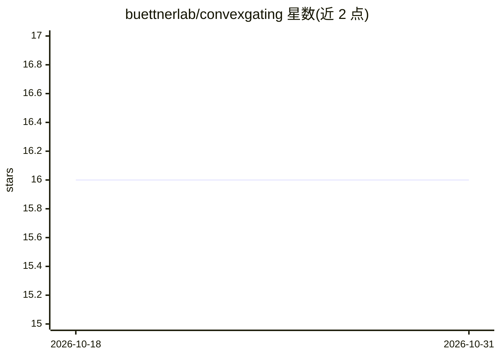

# buettnerlab/convexgating

⭐ 16 · Python · GPL-2.0 · 推送 2026-07-22 · [GitHub](https://github.com/buettnerlab/convexgating) · 组织维护

**从流式/质流/Ab-seq 数据推断最优门控策略的 Python 包**

面向单细胞流式与质流数据分析者的 Python 包：读取带标签的 AnnData 输入（如聚类结果），为每个目标群推断可分离该群与其他事件的门控层级，输出门控面板及每个门的纯度（precision）、产率（recall）与 F1 分数。依赖 scanpy/anndata 做数据格式与预处理，用 PyTorch 随机梯度下降迭代寻优，因此结果可能略有波动。通过 pip 安装，推荐 Python 3.9；在 Windows/Linux 测试通过，Apple Silicon M1/M2 存在问题。

## 筛选速览

| 维度 | 判定 | 备注 |
|---|---|---|
| AI 角色 | `ai-native` | 本体是模型或模型工具 |
| 许可风险 | `viral` | GPL-2.0 |
| 部署形态 | `library` | 以包/库形式分发 |
| 模型依赖 | — | README 未给出锁定关系 |
| 硬件要求 | — | 无带数字的原话,不猜 |
| 安装摩擦 | `low` | 无编译、无系统依赖或容器化 |
| 成熟度 | — | 结构信号不足 |

## 能力要点

- 从标签输入（聚类结果）推断最优门控策略与门控层级
- 为每个门报告纯度、产率与 F1 分数
- 支持单个或多个目标群的批量门控生成
- 基于 scanpy/anndata 数据格式与 PyTorch 优化

## 适用场景

- 为流式/质流实验的已聚类细胞群生成可复现的门控方案
- 评估候选门的纯度与产率以选择合适门控层级
- 为 Ab/CITE-seq 数据生成事件分离门控策略

## 场景标签

`数据分析` · 领域:效率与自动化

## 证据(README 行号)

> L37: ConvexGating is a Python package to infer an optimal gating strategy from flow, cyTOF or Ab/CITE-seq data. Convex g
> L38: For each cluster, it reports the purity (precision), yield (recall) and the harmonic mean of both metrics (F1 score

## 星数曲线

2026-10-18 16 → 2026-10-31 16（+0）

---
*卡片 v1 · prompt 1.4 · 生成 2026-10-30 · 置信度 high · 依据 README sha `c637225fd668` · [字段定义](../../DATASET.md)*
