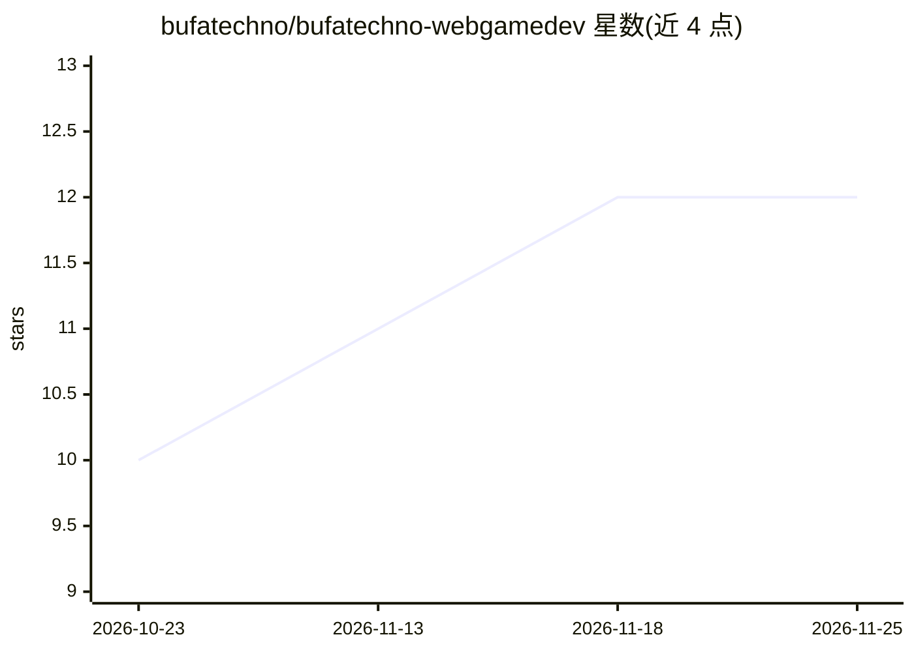

# bufatechno/bufatechno-webgamedev

⭐ 12 · JavaScript · MIT · 推送 2026-09-06 · [GitHub](https://github.com/bufatechno/bufatechno-webgamedev) · [官网](https://bufatechno.com) · 个人维护

**让 Claude/ZCode 等 agent 构建浏览器 3D 游戏的技能包**

一个面向 Claude Code / ZCode 类编码 agent 的 SKILL.md 技能包，用于指导 agent 完整构建基于 Three.js 或 Babylon.js 的浏览器 3D 游戏：覆盖项目脚手架（CDN/Vite 7 双路径）、游戏逻辑（固定步长、状态机、ECS）、图形与 VFX、音频、2D/3D 素材、动画、WebXR、性能优化与部署发布流程。核心为约 375 行主文件加 22 个按需引用的参考文档，默认 Lite 配置零新增依赖（约 300KB），重型库严格按需启用并提供 Lite 回退；针对 ≤14B 弱模型提供四步快速降级路径。

## 筛选速览

| 维度 | 判定 | 备注 |
|---|---|---|
| AI 角色 | `ai-knowledge` | 知识聚合/清单类 |
| 许可风险 | `permissive` | MIT |
| 部署形态 | `None` |  |
| 模型依赖 | — | README 未给出锁定关系 |
| 硬件要求 | — | 无带数字的原话,不猜 |
| 安装摩擦 | `low` | 无编译、无系统依赖或容器化 |
| 成熟度 | — | 结构信号不足 |

## 能力要点

- SKILL.md 主文件 + 22 个按需参考文档的渐进式披露结构
- Path A 双击 CDN 与 Path B Vite 7 两种运行路径
- Lite 默认零新增依赖（约 300KB），Full 库逐类 opt-in 带回退
- 含 ≤14B 弱模型的 4 步 Quick Start 降级路径

## 适用场景

- 让编码 agent 按提示直接生成可运行的 FPS/体素/RPG 等浏览器 3D 游戏
- 为 WebXR 或多人浏览器游戏项目生成脚手架与系统实现
- 在弱小本地模型上以 Lite 路径生成轻量游戏项目

## 场景标签

`代码生成` · 领域:编码与开发

## 证据(README 行号)

> L3: Skill **optimized for ZCode & Claude (primary)** to build **complete, production-ready 3D web games** using **Three.
> L36: Skill will: intake 10 questions → design professional architecture → select framework (matrix 2026) → scaffold (CDN
> L51: ├── SKILL.md                       # Main skill — professional ~375 lines (core) + Weak-Model Quick Start

## 星数曲线

2026-10-23 10 → 2026-11-25 12（+2）

---
*卡片 v1 · prompt 1.4 · 生成 2026-11-18 · 置信度 high · 依据 README sha `5118ddff0149` · [字段定义](../../DATASET.md)*
