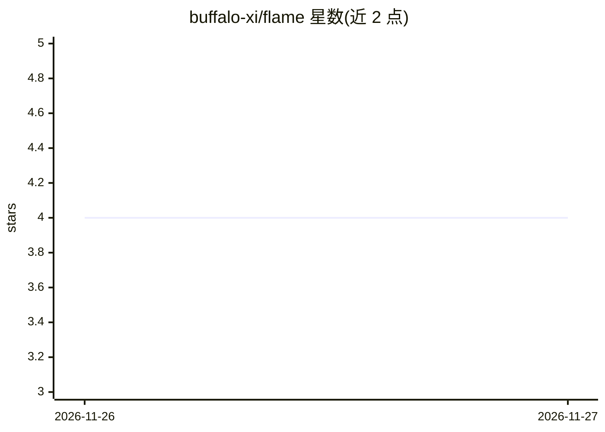

# buffalo-xi/flame

⭐ 4 · Go · Apache-2.0 · 推送 2026-11-26 · [GitHub](https://github.com/buffalo-xi/flame) · 个人维护 · 中文 README

**给团队用的多租户 AI agent 平台：构建/编排 agent 并以 MCP/RPC 暴露**

Go 编写的多租户 AI agent 平台，将 agent、技能、工具、工作流作为一等构建物管理，并可通过 MCP 或 RPC 端点对外暴露，运行状态汇集在单一 runtime ledger 中查看与取消。内置 Vue 3 管理台，多租户采用 PostgreSQL 每租户一 schema，脚本在 docker/nsjail 沙箱中隔离执行，支持配额、资产市场与模型/连接配置。提供 docker compose 双容器 PoC 演示与 GHCR 生产镜像的分阶段部署路径。

## 筛选速览

| 维度 | 判定 | 备注 |
|---|---|---|
| AI 角色 | `ai-ecosystem` | LLM/agent 周边工具 |
| 许可风险 | `permissive` | Apache-2.0 |
| 部署形态 | `self-host` | docker 或自建部署 |
| 模型依赖 | — | README 未给出锁定关系 |
| 硬件要求 | — | 无带数字的原话,不猜 |
| 安装摩擦 | `low` | 无编译、无系统依赖或容器化 |
| 成熟度 | `idea` | |

## 能力要点

- agent/技能/工具/工作流以 MCP 或 RPC 端点暴露，按租户开关
- 可视化工作流编排（节点/边/变量）带调试器与版本发布
- 跨实例 runtime ledger 与运行历史（可查询、导出 CSV、可取消）
- 沙箱隔离执行（docker/nsjail/none）与每租户 schema 多租户

## 适用场景

- 为企业内部构建并托管多个租户的 AI agent 与工作流
- 把 agent 或工作流作为 MCP/RPC 端点供外部调用
- 集中查看、过滤并取消正在运行的 agent 与工作流实例

## 场景标签

`Agent 框架` `工作流自动化` · 领域:Agent 开发

## 证据(README 行号)

> L5: A Go-based, multi-tenant AI agent platform. It manages agents, skills, tools and workflows as first-class build arti
> L6: exposes them as callable endpoints (MCP / RPC), and shows everything currently running in a single runtime ledger.
> L33: - **Endpoints** — expose an agent or a workflow as an MCP or RPC entry point, with a per-tenant "expose / retract" 

## 星数曲线

2026-11-26 4 → 2026-11-27 4（+0）

---
*卡片 v1 · prompt 1.4 · 生成 2026-11-26 · 置信度 high · 依据 README sha `7f8245e745fe` · [字段定义](../../DATASET.md)*
