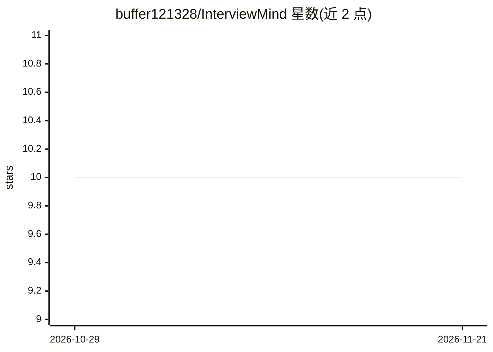

# buffer121328/InterviewMind

⭐ 10 · Python · NOASSERTION · 推送 2026-11-10 · [GitHub](https://github.com/buffer121328/InterviewMind) · 个人维护 · 中文 README

**面向求职者的 LangGraph AI 面试模拟与简历优化系统**

基于 LangGraph 状态机的单端求职辅助平台：提供文字/语音多轮模拟面试（Mock/HR/Tech/Behavior 四模式、SSE 流式、多视角评审报告）、简历 6 阶段定向优化流水线、题库与 mem0+pgvector 长期记忆、BOSS 直聘半自动化岗位采集与投递。底层为可恢复的持久化 AgentRun 运行时、工具契约治理与 guardrails 校验，配套模型池网关、Langfuse 观测与 DeepEval 评测中心。通过 Docker Compose 全容器或源码方式部署，仅限本机单人使用，采用非商业许可证。

## 筛选速览

| 维度 | 判定 | 备注 |
|---|---|---|
| AI 角色 | `ai-native` | 本体是模型或模型工具 |
| 许可风险 | `none` | NOASSERTION |
| 部署形态 | `self-host` | docker 或自建部署 |
| 模型依赖 | — | README 未给出锁定关系 |
| 硬件要求 | — | 无带数字的原话,不猜 |
| 安装摩擦 | `low` | 无编译、无系统依赖或容器化 |
| 成熟度 | — | 结构信号不足 |

## 能力要点

- 四模式多轮模拟面试，四评审视角并行打分生成结构化复盘报告
- 简历优化固定 6 阶段流水线：改写-合并-核对夸大-高风险改动人工确认
- 持久化可恢复 AgentRun 运行时与工具副作用契约治理
- 内置评测中心：硬门禁 + DeepEval Judge + 人工标注三层结论

## 适用场景

- 求职前针对目标岗位做多场模拟面试并复盘短板
- 录入简历与 JD 生成定向优化的定制简历
- 从 BOSS 直聘采集岗位并生成打招呼文案（人工确认投递）
- 本地学习 Agent 工作流工程化实现（任务编排/治理/评测）

## 场景标签

`AI 助手` `AI 写作` · 领域:对话与助手

## 证据(README 行号)

> L33: 面必过是一个面向求职者的单端求职辅助系统，不包含 HR 工作台。它利用大语言模型（LLM）、模型池网关和 LangGraph 状态机提供模拟面试、简历诊断与定向优化、能力复盘和投递管理，帮助求职者提升求职准备效率。
> L39: **模拟面试（文字 / 语音）**：基于 LangGraph 状态机的多轮模拟面试，支持 Mock / HR / Tech / Behavior 四种模式与 SSE 流式输出。语音链路走浏览器录音 → MiMo ASR → 文本对

## 星数曲线

2026-10-29 10 → 2026-11-21 10（+0）

---
*卡片 v1 · prompt 1.4 · 生成 2026-11-19 · 置信度 high · 依据 README sha `8e371f10210b` · [字段定义](../../DATASET.md)*
