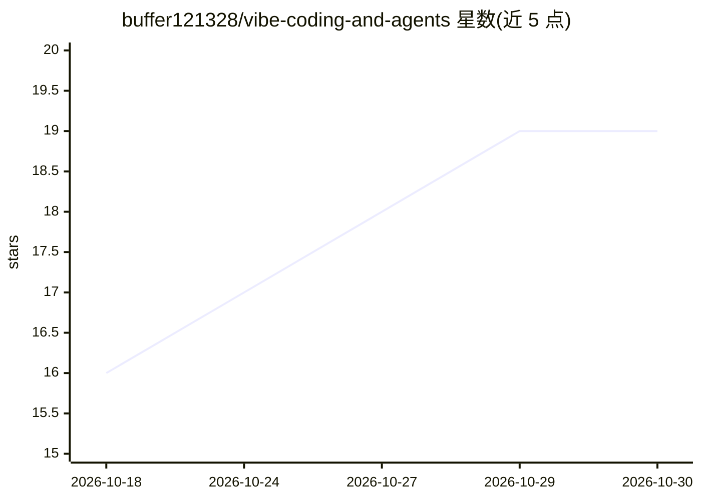

# buffer121328/vibe-coding-and-agents

⭐ 19 · Python · NOASSERTION · 推送 2026-09-25 · [GitHub](https://github.com/buffer121328/vibe-coding-and-agents) · 个人维护 · 中文 README

**面向零基础到进阶开发者的 Vibe Coding 与 Agent 中文教程知识库**

个人编写的开源教程知识库，全书 14 章、140+ 篇文章，以中文系统讲解 AI 辅助编程与 Agent 开发：入门概念扫盲、Dify/OpenCode/Codex/Trae 等工具使用指南、手搓 mini Agent 讲解底层原理、LangChain 与 LangGraph 框架入门、RAG 工程实战，以及 AI 能力界限、Token 计费、面试题体系等。提供在线文档站与三条按时间预算划分的学习路径。采用自定义许可：允许个人学习，禁止商业化，商业使用需另行联系授权。项目声明为初版仍在完善，模型微调实战部分尚未覆盖。

## 筛选速览

| 维度 | 判定 | 备注 |
|---|---|---|
| AI 角色 | `ai-knowledge` | 知识聚合/清单类 |
| 许可风险 | `none` | NOASSERTION |
| 部署形态 | `None` |  |
| 模型依赖 | — | README 未给出锁定关系 |
| 硬件要求 | — | 无带数字的原话,不猜 |
| 安装摩擦 | `low` | 无编译、无系统依赖或容器化 |
| 成熟度 | `idea` | |

## 能力要点

- 14 章 140+ 篇中文文章，覆盖概念、工具实战、Agent 原理与框架
- 手搓 mini Agent 章节讲解 Agent 底层运行机制
- RAG 实战章节含 12 个可跑脚本与总装项目
- 三条按时间与目标划分的学习路径（快速上手/系统学习/内功修炼）

## 适用场景

- 零基础入门 AI 辅助编程并快速做出可展示的 Agent 项目
- 传统开发者转型 AI 驱动的开发方式
- 准备 Agent 开发岗位的面试与体系化查漏补缺

## 场景标签

`教程课程` · 领域:学习与行业

## 证据(README 行号)

> L24: 本项目是一个**完全开源、面向零基础到进阶开发者的现代 AI 辅助编程与 Agent 智能体全景指南**。
> L3:  用清楚自然的中文讲透原理 · 从 0 到 1 搭建 Agent · 串联 Dify / OpenCode / LangChain / LangGraph / RAG 工程实践

## 星数曲线

2026-10-18 16 → 2026-10-30 19（+3）

---
*卡片 v1 · prompt 1.4 · 生成 2026-10-29 · 置信度 high · 依据 README sha `8a4a4acc58d5` · [字段定义](../../DATASET.md)*
