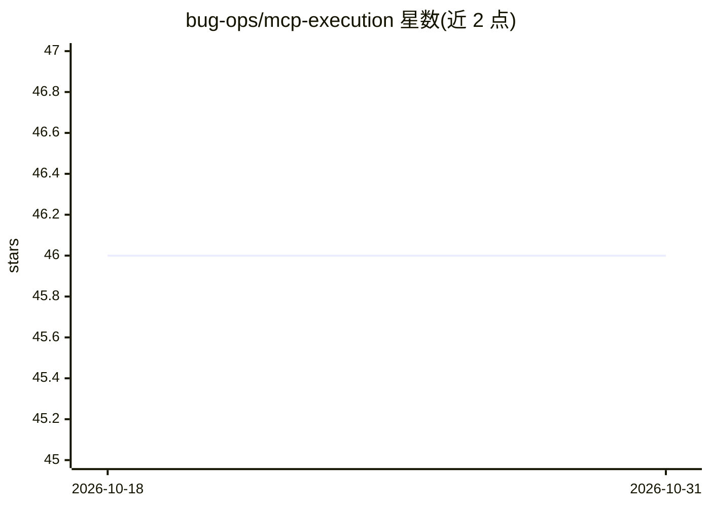

# bug-ops/mcp-execution

⭐ 46 · Rust · NOASSERTION · 推送 2026-10-27 · [GitHub](https://github.com/bug-ops/mcp-execution) · 组织维护

**把 MCP 服务器转成可执行 TypeScript 工具，节省 token**

Rust 编写的 MCP 工具代码生成器：内省任意 MCP 服务器，按渐进式加载模式为每个工具生成一个独立 TypeScript 文件（约 500-1,500 token），AI agent 通过 ls/cat 按需加载，README 称相对全量加载（约 30,000 token）节省 98% token。提供 CLI（cargo 安装或预编译二进制）与多个可独立引用的库 crate，另支持生成 Claude Code 用的 SKILL.md 与一个 MCP server crate。面向为 AI agent 接入 MCP 工具的开发者。注意 v0.9 已移除独立 npm runtime 包，v0.10 有破坏性 schema 变更，需 Rust 1.91+ 源码构建。

## 筛选速览

| 维度 | 判定 | 备注 |
|---|---|---|
| AI 角色 | `ai-ecosystem` | LLM/agent 周边工具 |
| 许可风险 | `none` | NOASSERTION |
| 部署形态 | `library` | 以包/库形式分发 |
| 模型依赖 | — | README 未给出锁定关系 |
| 硬件要求 | — | 无带数字的原话,不猜 |
| 安装摩擦 | `low` | 无编译、无系统依赖或容器化 |
| 成熟度 | — | 结构信号不足 |

## 能力要点

- 渐进式加载：每工具一个自包含 TypeScript 文件，agent 按需 ls/cat
- 基于 rmcp SDK 内省并兼容任意 MCP 服务器，从 MCP JSON schema 生成类型接口
- 多 crate 工作区：core/introspector/codegen/files/skill/server/cli 可单独引用
- 生成 Claude Code 集成用的 SKILL.md（mcp-execution-cli skill）

## 适用场景

- 为 AI agent 只加载所需的 MCP 工具，减少上下文占用
- 把现有 MCP 服务器工具转成可直接经 Node.js 运行的类型安全 TypeScript 文件
- 在 Claude Code 中以技能文档方式集成 MCP 工具

## 场景标签

`代码生成` · 领域:编码与开发

## 证据(README 行号)

> L10: Transform any MCP server into executable, type-safe TypeScript tools using progressive loading pattern. Achieve **9
> L21: Progressive loading generates one TypeScript file per tool (~500-1,500 tokens each). AI agents discover and load on
> L118: |mcp-execution-introspector|MCP server analysis using rmcp SDK|

## 星数曲线

2026-10-18 46 → 2026-10-31 46（+0）

---
*卡片 v1 · prompt 1.4 · 生成 2026-10-25 · 置信度 high · 依据 README sha `ba68d2ccff37` · [字段定义](../../DATASET.md)*
