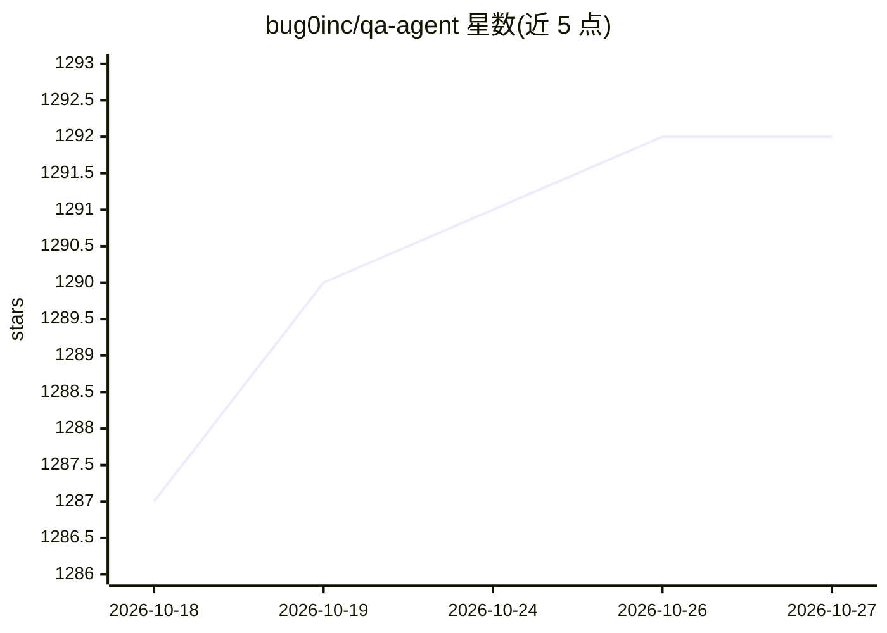

# bug0inc/qa-agent

⭐ 1,292 · TypeScript · NOASSERTION · 推送 2026-09-25 · [GitHub](https://github.com/bug0inc/qa-agent) · [官网](https://ai.bug0.com) · 组织维护

**用 AI 执行自然语言步骤的 Playwright 回归测试库**

基于 Playwright 的开源浏览器回归测试库，以 npm 包 @bug0/ai 提供。测试步骤用自然语言编写，由 AI 模型（默认 Gemini 系列执行步骤）经 Playwright 执行；断言采用 Claude 与 Gemini 双模型共识，分歧时可由仲裁模型裁决或直接判失败。支持 Redis 步骤缓存与缓存失败时的自动修复、视频断言（上传 .webm 到 Gemini Files API 评估）、动态占位符与 AI 数据抽取。可经 Vercel/OpenRouter/Cloudflare 等 AI 网关路由请求，需配置对应 API key；CUA 模式走 OpenAI computer-use agent 且不兼容网关。面向编写端到端测试的前端/QA 开发者，尤其用于覆盖 agent 生成代码的回归检查。

## 筛选速览

| 维度 | 判定 | 备注 |
|---|---|---|
| AI 角色 | `ai-ecosystem` | LLM/agent 周边工具 |
| 许可风险 | `none` | NOASSERTION |
| 部署形态 | `library` | 以包/库形式分发 |
| 模型依赖 | locked-api |  |
| 硬件要求 | — | 无带数字的原话,不猜 |
| 安装摩擦 | `low` | 无编译、无系统依赖或容器化 |
| 成熟度 | — | 结构信号不足 |

## 能力要点

- 自然语言步骤由 AI 经 Playwright 执行，支持 Redis 缓存与自动修复
- Claude+Gemini 双模型共识断言，可配置仲裁策略或分歧即失败
- 视频断言：录制步骤全程并经 Gemini Files API 整段评估
- 8 个可配置模型槽位，支持 Vercel/OpenRouter/Cloudflare 等 AI 网关

## 适用场景

- 用自然语言编写并运行浏览器端到端回归测试
- 为 agent 生成代码的 PR 提供自愈式回归检查
- 验证瞬态 UI（toast/snackbar）等单截图易漏的场景

## 场景标签

`浏览器自动化` · 领域:效率与自动化

## 证据(README 行号)

> L11: It uses AI models to execute natural language browser steps via Playwright, with intelligent caching, auto-healing,
> L113: - **Core Execution** — `runSteps()` and `runUserFlow()` for flexible test orchestration in natural language, with 

## 星数曲线

2026-10-18 1,287 → 2026-10-27 1,292（+5）

---
*卡片 v1 · prompt 1.4 · 生成 2026-10-21 · 置信度 high · 依据 README sha `c4b47a3e6379` · [字段定义](../../DATASET.md)*
