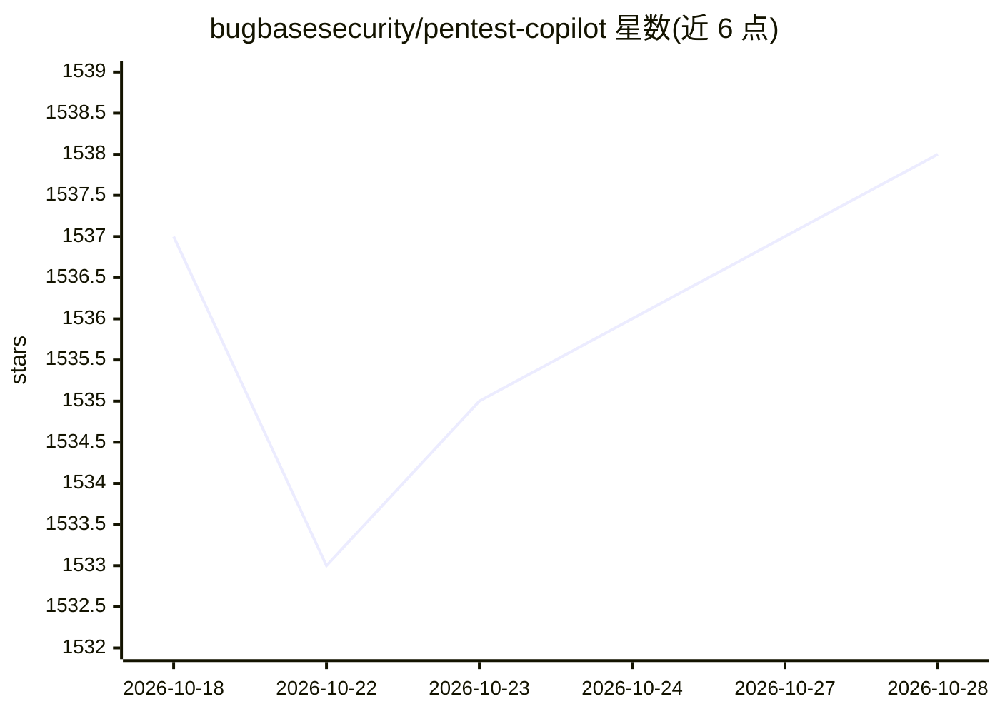

# bugbasesecurity/pentest-copilot

⭐ 1,538 · TypeScript · MIT · 推送 2026-08-14 · [GitHub](https://github.com/bugbasesecurity/pentest-copilot) · [官网](https://pentest.bugbase.ai) · 组织维护

**面向渗透测试的 AI agent：连接攻击机自主执行测试**

开源的 AI 渗透测试 agent，通过浏览器界面使用：连接 Kali 攻击盒后自主运行命令、读取输出、决定下一步并循环（每轮最多 25 次迭代）。内置 16 个 agent 工具（bash、浏览器自动化、Burp Suite 集成、Google 搜索、子 agent 并行等）与 100+ 安全工具注册表，支持 VPN 配置管理与危险命令人工审批。可接入 OpenAI、Anthropic、Google、Mistral、OpenAI 兼容端点，或复用已认证的 Codex/Claude Code CLI 订阅。需 Docker 部署，最低 8GB 内存，仅限授权测试场景。

## 筛选速览

| 维度 | 判定 | 备注 |
|---|---|---|
| AI 角色 | `ai-native` | 本体是模型或模型工具 |
| 许可风险 | `permissive` | MIT |
| 部署形态 | `self-host` | docker 或自建部署 |
| 模型依赖 | locked-api |  |
| 硬件要求 | — | 无带数字的原话,不猜 |
| 安装摩擦 | `low` | 无编译、无系统依赖或容器化 |
| 成熟度 | — | 结构信号不足 |

## 能力要点

- 自主 agent 循环：运行命令、读取输出、迭代决策，每轮最多 25 次
- 16 个 agent 工具与 100+ 安全工具注册表（7 类）
- Burp Suite 集成（代理历史/Repeater/Intruder/Collaborator）与浏览器自动化
- 自带模型：支持 OpenAI/Anthropic/Google/Mistral 或任意 OpenAI 兼容端点

## 适用场景

- 渗透测试实战中让 agent 自主执行侦察与利用流程
- CTF 与 boot2root 靶机的自动化解题
- 通过浏览器自动化测试登录流程与 JS 重度应用
- 通过 MCP 端点将测试能力暴露给 Claude Code/Codex 等客户端

## 场景标签

`网络安全` · 领域:学习与行业

## 证据(README 行号)

> L9: An open-source, AI-driven penetration testing agent. Connects to a Kali attack box, runs tools autonomously, analyze
> L25: - **Agentic execution** - the AI runs commands directly on the attack box, reads output, decides next steps, and lo
> L26: - **16 agent tools** - bash, Python scripts, tool installation, shell management, Google search, subagent spawning,

## 星数曲线

2026-10-18 1,537 → 2026-10-28 1,538（+1）

---
*卡片 v1 · prompt 1.4 · 生成 2026-10-21 · 置信度 mid · 依据 README sha `d56e4ef7200d` · [字段定义](../../DATASET.md)*
