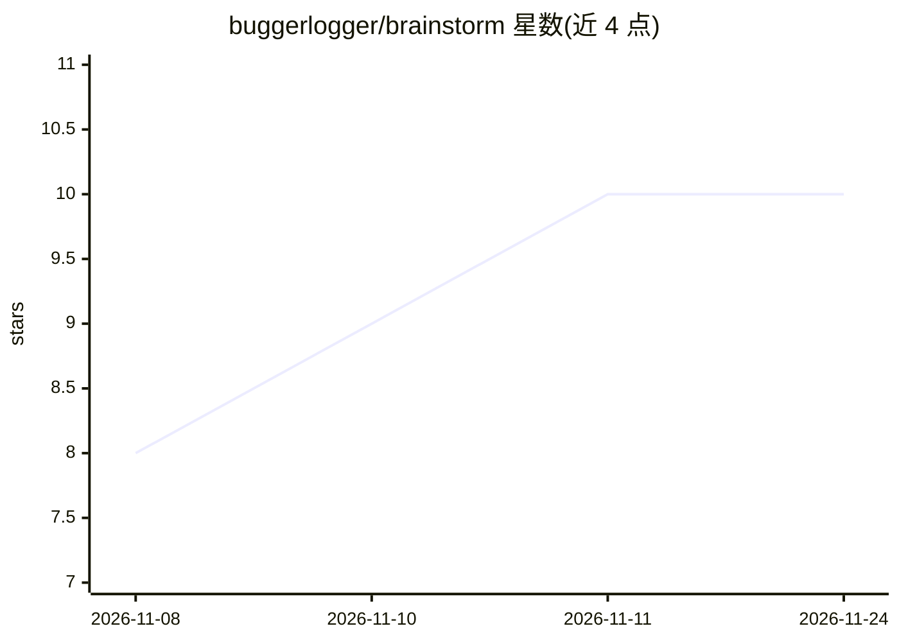

# buggerlogger/brainstorm

⭐ 10 · JavaScript · Apache-2.0 · 推送 2026-11-05 · [GitHub](https://github.com/buggerlogger/brainstorm) · [官网](https://github.com/buggerlogger/brainstorm/releases/latest) · 个人维护

**面向 Claude Code 用户的上下文调试与编辑器**

brainstorm 是 Claude Code 的上下文调试器和编辑器（beta，Windows exe）。它展示 Claude Code 发送给模型的每个上下文块，支持实时观察请求（等待 API、思考、工具调用、缓存读写）、编辑/删除/固定任意块，然后通过 Save & Resume 在同一终端重启被编辑的会话。主上下文机制把固定内容放回每轮第一条消息，build 步骤按 API 校验规则拒绝非法编辑。通过 exe 单文件运行，或 npx setup 安装插件与应用。

## 筛选速览

| 维度 | 判定 | 备注 |
|---|---|---|
| AI 角色 | `ai-ecosystem` | LLM/agent 周边工具 |
| 许可风险 | `permissive` | Apache-2.0 |
| 部署形态 | `desktop` | 安装包/桌面程序 |
| 模型依赖 | — | README 未给出锁定关系 |
| 硬件要求 | — | 无带数字的原话,不猜 |
| 安装摩擦 | `low` | 无编译、无系统依赖或容器化 |
| 成熟度 | `idea` | |

## 能力要点

- 逐块查看并编辑 Claude Code 发送给模型的完整上下文
- Save & Resume：验证、安装新会话并在同一终端重启 claude
- Live 插件（brainstorm-live）从 claude 内部流式推送请求与工具调用事件
- 主上下文（◆）：每项目一条 pin，rewind 后重新插入

## 适用场景

- 调试 Claude Code 会话中模型实际收到的上下文
- 通过编辑上下文模板定位 bug
- 把持久事实固定到每次 rewind 都保留的主上下文
- 观察工具调用参数与 prompt cache 命中情况

## 场景标签

`提示工程` `LLM 可观测性` · 领域:Agent 开发

## 证据(README 行号)

> L1: See exactly what Claude Code sends to the model. Edit it. Resume.
> L20: brainstorm is a context debugger and editor for Claude Code. Open any session
> L21: and see every block of its context as claude is sent it; watch each request

## 星数曲线

2026-11-08 8 → 2026-11-24 10（+2）

---
*卡片 v1 · prompt 1.4 · 生成 2026-11-19 · 置信度 high · 依据 README sha `60a4d93cbf9f` · [字段定义](../../DATASET.md)*
