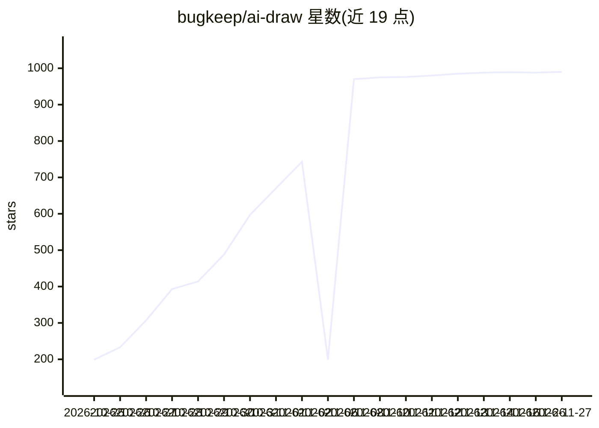

# bugkeep/ai-draw

⭐ 990 · Python · MIT · 推送 2026-10-26 · [GitHub](https://github.com/bugkeep/ai-draw) · 个人维护 · 中文 README

**通过对话创建和编辑图表与插画的画布应用**

Draw Agent Studio 是一个自托管的 Web 画布应用：用户以自然语言描述生成素描、插画与流程图，并通过对话移动对象、改色、删除、撤销重做；同时保留手绘能力，可在画布上选择、拖拽、用笔绘制与添加文字。画布自动保存，可导出 PNG/JPG/WebP/SVG 及可编辑的 Excalidraw 文件。需 Python 3.11+ 与 Node.js 20.19+，模型调用按所选服务商计费，要求模型具备图像输入与工具调用能力。

## 筛选速览

| 维度 | 判定 | 备注 |
|---|---|---|
| AI 角色 | `ai-native` | 本体是模型或模型工具 |
| 许可风险 | `permissive` | MIT |
| 部署形态 | `library` | 以包/库形式分发 |
| 模型依赖 | — | README 未给出锁定关系 |
| 硬件要求 | — | 无带数字的原话,不猜 |
| 安装摩擦 | `low` | 无编译、无系统依赖或容器化 |
| 成熟度 | — | 结构信号不足 |

## 能力要点

- 文本描述生成素描、插画与流程图
- 对话式编辑：移动、改色、删除、撤销/重做
- 画布手绘与文字添加，自动保存
- 导出 PNG/JPG/WebP/SVG 与可编辑 Excalidraw 文件

## 适用场景

- 用自然语言生成科研流程图并迭代修改
- 对话生成插画草稿后手工补画完成
- 将作品导出为 Excalidraw 继续编辑

## 场景标签

`科研工具` `图像生成` · 领域:内容生成

## 证据(README 行号)

> L2:  Draw and edit through conversation.
> L21: - **Describe**: Create sketches, illustrations, and flowcharts from text.
> L58: Choose OpenAI, Claude, Gemini, Ark, or another provider, or connect a local service or custom compatible endpoint. 

## 星数曲线

2026-10-25 199 → 2026-11-27 990（+791）

---
*卡片 v1 · prompt 1.4 · 生成 2026-11-24 · 置信度 high · 依据 README sha `e74bab78c524` · [字段定义](../../DATASET.md)*
