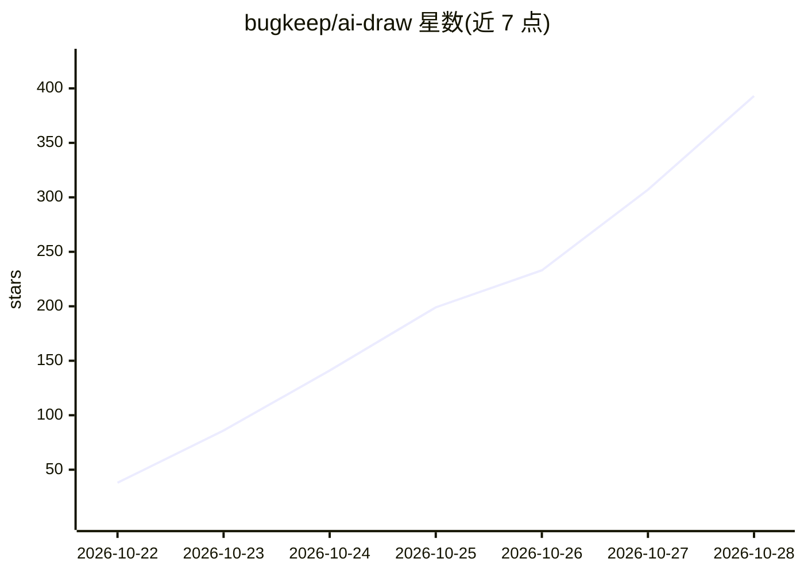

# bugkeep/ai-draw

⭐ 414 · Python · MIT · 推送 2026-10-26 · [GitHub](https://github.com/bugkeep/ai-draw) · 个人维护 · 中文 README

**通过对话生成和编辑草图、插图与流程图的自托管绘图应用**

基于 Excalidraw 画布的对话式绘图工具：用户用自然语言生成草图、插图和流程图，通过对话移动对象、改颜色、删除、撤销重做，也可直接手绘编辑。画布自动保存，可导出 PNG/JPG/WebP/SVG 及可编辑的 Excalidraw 文件。模型由用户自行接入：在设置中选择 OpenAI、Claude、Gemini、Ark 等供应商或本地/自定义兼容端点，需支持图像输入与工具调用。从源码运行，要求 Python 3.11+ 与 Node.js 20.19+。

## 筛选速览

| 维度 | 判定 | 备注 |
|---|---|---|
| AI 角色 | `ai-native` | 本体是模型或模型工具 |
| 许可风险 | `permissive` | MIT |
| 部署形态 | `library` | 以包/库形式分发 |
| 模型依赖 | — | README 未给出锁定关系 |
| 硬件要求 | — | 无带数字的原话,不猜 |
| 安装摩擦 | `low` | 无编译、无系统依赖或容器化 |
| 成熟度 | — | 结构信号不足 |

## 能力要点

- 从文本生成草图、插图与流程图
- 通过对话移动对象、改色、删除、撤销重做
- 支持手动绘制与画布直接编辑
- 导出 PNG/JPG/WebP/SVG 及可编辑 Excalidraw 文件
- 自选供应商或本地/自定义兼容端点接入模型

## 适用场景

- 用自然语言快速画出研究流程图并迭代修改
- 生成插画草图后手动补充细节
- 自托管部署进行对话式绘图创作

## 场景标签

`图像生成` · 领域:内容生成

## 证据(README 行号)

> L21: - **Describe**: Create sketches, illustrations, and flowcharts from text.
> L45: 1. Choose a provider and enter the model name, API URL, and API key.

## 星数曲线

2026-10-22 38 → 2026-10-28 393（+355）

---
*卡片 v1 · prompt 1.4 · 生成 2026-10-23 · 置信度 mid · 依据 README sha `510a23f3f716` · [字段定义](../../DATASET.md)*
