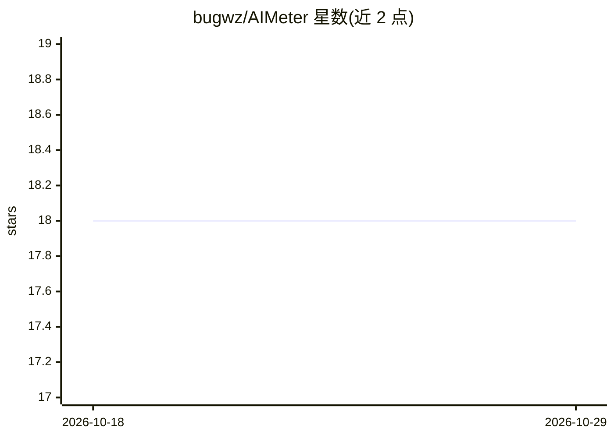

# bugwz/AIMeter

⭐ 18 · TypeScript · MIT · 推送 2026-03-15 · [GitHub](https://github.com/bugwz/AIMeter) · [官网](https://aimeter.cc/) · 个人维护 · 中文 README

**自托管面板：集中追踪多家 AI 服务的用量、额度与历史**

React 前端 + Express 后端的自托管仪表盘，通过多供应商适配器架构统一追踪 Claude、Codex、Kimi、MiniMax、OpenRouter、Ollama、Cursor、Copilot 等 14 家 AI 服务的用量、配额与历史趋势，支持凭据管理与端点/代理 API 页面。存储支持 SQLite/Cloudflare D1/PostgreSQL/MySQL，运行模式分 node 与 serverless，可部署到 Docker、Vercel、Cloudflare Workers（内置 Cron Triggers 每 5 分钟刷新）。配置经 config.yaml 或环境变量，需指定数据库引擎与连接串。

## 筛选速览

| 维度 | 判定 | 备注 |
|---|---|---|
| AI 角色 | `ai-ecosystem` | LLM/agent 周边工具 |
| 许可风险 | `permissive` | MIT |
| 部署形态 | `self-host` | docker 或自建部署 |
| 模型依赖 | local-ok | 支持本地模型 |
| 硬件要求 | — | 无带数字的原话,不猜 |
| 安装摩擦 | `low` | 无编译、无系统依赖或容器化 |
| 成熟度 | — | 结构信号不足 |

## 能力要点

- 14 家 AI 供应商统一用量/额度仪表盘
- 多数据库引擎：SQLite / Cloudflare D1 / PostgreSQL / MySQL
- node 与 serverless 两种运行模式
- Docker 单容器 / Vercel / Cloudflare Workers 三种部署路径

## 适用场景

- 在一个面板查看多家 AI 服务的剩余额度与消耗趋势
- 为团队或个人自托管 AI 用量记账与历史追踪
- 在 Cloudflare Workers 上零成本定时刷新用量数据

## 场景标签

`LLM 可观测性` · 领域:评测与运维

## 证据(README 行号)

> L5: AIMeter is a self-hosted dashboard for tracking AI provider usage, quota, and historical trends.
> L32: - Unified dashboard across multiple AI providers

## 星数曲线

2026-10-18 18 → 2026-10-29 18（+0）

---
*卡片 v1 · prompt 1.4 · 生成 2026-10-29 · 置信度 high · 依据 README sha `e1f0b9369cde` · [字段定义](../../DATASET.md)*
