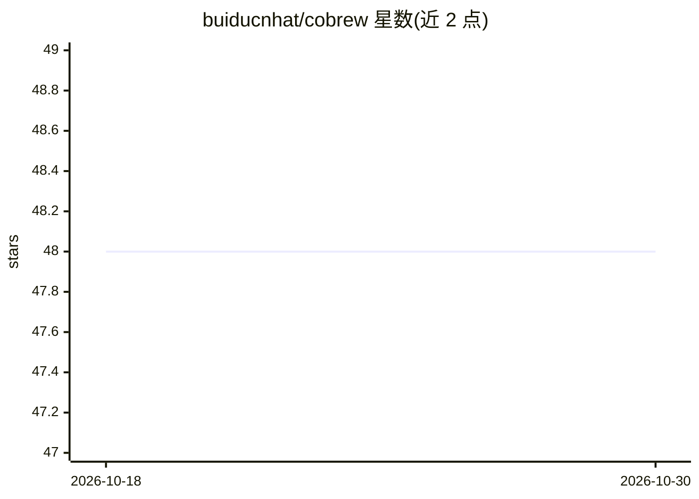

# buiducnhat/cobrew

⭐ 48 · HTML · 推送 2026-07-06 · [GitHub](https://github.com/buiducnhat/cobrew) · [官网](https://github.com/buiducnhat/cobrew) · 个人维护 · 中文 README

**面向编码 agent 的标准化工作流技能包，含 10 个技能**

为 AI 编码 agent 提供第一方工作流技能的仓库：定义 ask、fix、review、brainstorm、docs、write-plan、execute-plan、quick-implement、git-commit、visualize 共 10 个技能，通过两条路径分发——Codex 与 Claude Code 的插件市场（同一插件包含双方 manifest），以及其他 40 种受支持 agent 经 Vercel skills CLI（npx skills add）直接安装技能。各技能自带项目上下文加载指引，并给出按任务复杂度选用的推荐工作流序列。要求 Node.js 18+ 与网络访问。

## 筛选速览

| 维度 | 判定 | 备注 |
|---|---|---|
| AI 角色 | `ai-ecosystem` | LLM/agent 周边工具 |
| 许可风险 | `none` | — |
| 部署形态 | `library` | 以包/库形式分发 |
| 模型依赖 | — | README 未给出锁定关系 |
| 硬件要求 | — | 无带数字的原话,不猜 |
| 安装摩擦 | `low` | 无编译、无系统依赖或容器化 |
| 成熟度 | — | 结构信号不足 |

## 能力要点

- 10 个第一方工作流技能（brainstorm/plan/execute/fix/review 等）
- 同一插件包同时支持 Codex 与 Claude Code 插件市场
- npx skills add 可安装到其他约 40 种 agent
- 提供按任务复杂度划分的推荐工作流序列

## 适用场景

- 为我的编码 agent 配置标准化的计划-执行工作流
- 让 agent 按规范生成提交信息与项目文档
- 将源码旁的文档和计划可视化为 HTML 图

## 场景标签

`Agent 框架` · 领域:Agent 开发

## 证据(README 行号)

> L3: Install standardized AI workflow skills for coding agents.
> L13: 1. **Plugin bundles for Codex and Claude Code** expose self-contained workflow skills directly through each agent's
> L45: npx skills add buiducnhat/cobrew

## 星数曲线

2026-10-18 48 → 2026-10-30 48（+0）

---
*卡片 v1 · prompt 1.4 · 生成 2026-10-25 · 置信度 high · 依据 README sha `56654bfe81f2` · [字段定义](../../DATASET.md)*
