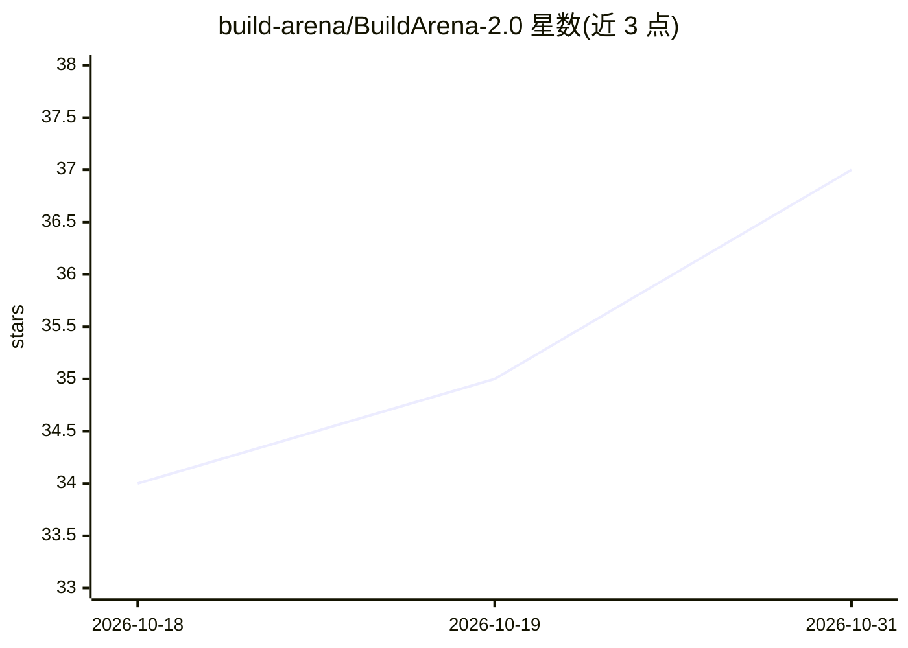

# build-arena/BuildArena-2.0

⭐ 37 · Python · NOASSERTION · 推送 2026-09-22 · [GitHub](https://github.com/build-arena/BuildArena-2.0) · [官网](https://build-arena.github.io/ConstructionChallenge/) · 组织维护 · 中文 README

**让 LLM agent 在 Besiege 中造机器并闭环控制的工程竞技场**

BuildArena 2.0 是面向 AI agent 的工程建造环境：在物理沙盒游戏 Besiege 中提供自动启动游戏、机器建造、闭环控制、遥测与时间线回放的端到端工作流，通过 Python 接口与 MCP 工具供 agent 调用，并附 Construction Challenge 赛道、评分与提交规范。使用前提严格：需 Windows/Linux/macOS 上装有 Steam、正版 Besiege 及两个 DLC，并订阅指定 Workshop 模组 BuildArena ToolKit；仓库不含游戏本体。一键 setup 校验环境并生成 mcp.json，附带火箭入轨返回等示例与 Blender 渲染构建动画脚本。

## 筛选速览

| 维度 | 判定 | 备注 |
|---|---|---|
| AI 角色 | `ai-ecosystem` | LLM/agent 周边工具 |
| 许可风险 | `none` | NOASSERTION |
| 部署形态 | `None` |  |
| 模型依赖 | — | README 未给出锁定关系 |
| 硬件要求 | — | 无带数字的原话,不猜 |
| 安装摩擦 | `low` | 无编译、无系统依赖或容器化 |
| 成熟度 | — | 结构信号不足 |

## 能力要点

- 自动化游戏启动、机器建造、闭环控制、遥测与时间线回放的完整链路
- 提供 Python 接口与 MCP 工具供 agent 接入
- 一键 setup 配置路径、校验方块数据并运行两项游戏内测试
- 从动作历史 JSON 重建机器，可用 Blender 渲染构建过程动画

## 适用场景

- 让 LLM agent 在物理仿真中设计、建造并驾驶机器
- 参加 Construction Challenge 建造挑战并提交作品工件
- 研究者评估 agent 的端到端工程建造与控制能力

## 场景标签

`模型评测` · 领域:评测与运维

## 证据(README 行号)

> L13: It gives AI agents an end-to-end engineering workflow in
> L16: replay**, with a Python interface and **MCP tools**. Powered by
> L18: and the Besiege CLI, agents can build a machine, run it, observe its behavior, and

## 星数曲线

2026-10-18 34 → 2026-10-31 37（+3）

---
*卡片 v1 · prompt 1.4 · 生成 2026-10-25 · 置信度 high · 依据 README sha `edc78dd013aa` · [字段定义](../../DATASET.md)*
