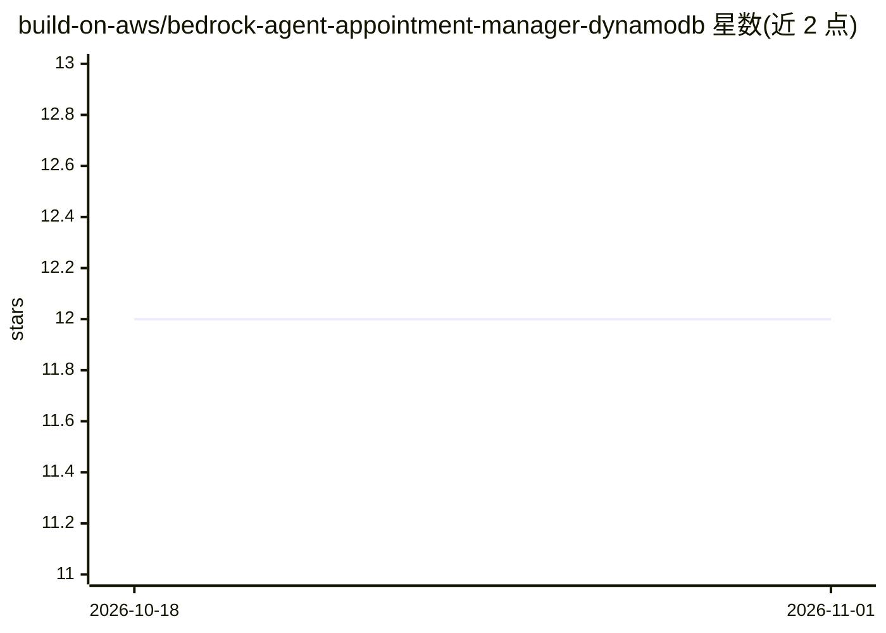

# build-on-aws/bedrock-agent-appointment-manager-dynamodb

⭐ 12 · Python · MIT-0 · 推送 2026-04-13 · [GitHub](https://github.com/build-on-aws/bedrock-agent-appointment-manager-dynamodb) · 组织维护

**用 CDK 部署的 Amazon Bedrock 预约管理对话 agent 示例**

AWS build-on-aws 的示例工程：通过 AWS CDK 一条命令部署 Amazon Bedrock Agent，使用户以自然语言操作 DynamoDB 预约表（SpanAppointment/GetAppointment/AskTodayDate 三个 action group，由 Lambda 执行），并关联 Knowledge Bases for Amazon Bedrock 提供基于知识库的个性化按摩推荐。agent 与知识库/action group 定义放在 JSON 文件中，可切换构建四种 agent 类型。面向有 AWS 账号和 Python 基础的开发者，产生 Bedrock/Lambda/DynamoDB 使用费用。

## 筛选速览

| 维度 | 判定 | 备注 |
|---|---|---|
| AI 角色 | `ai-ecosystem` | LLM/agent 周边工具 |
| 许可风险 | `permissive` | MIT-0 |
| 部署形态 | `library` | 以包/库形式分发 |
| 模型依赖 | locked-api |  |
| 硬件要求 | — | 无带数字的原话,不猜 |
| 安装摩擦 | `low` | 无编译、无系统依赖或容器化 |
| 成熟度 | — | 结构信号不足 |

## 能力要点

- 三条 action group 经 Lambda 执行 DynamoDB 读写与日期查询
- 集成 Bedrock Knowledge Base 做个性化推荐
- CDK 一键部署，可按 JSON 定义切换四种 agent 类型
- agent/action group/知识库配置均由 JSON 文件定义

## 适用场景

- 参考如何用 CDK 搭建 Bedrock Agent 与 Lambda action group
- 搭建自然语言查询和写入 DynamoDB 预约数据的原型
- 学习 Bedrock Agent 与 Knowledge Base 的集成方式

## 场景标签

`Agent 框架` `RAG` · 领域:Agent 开发

## 证据(README 行号)

> L3: Agents for Amazon Bedrock enable developers to create conversational agents that understand natural language through
> L5: I'll guide you through setting up the resources, defining the agent's action groups, associating AWS Lambda function

## 星数曲线

2026-10-18 12 → 2026-11-01 12（+0）

---
*卡片 v1 · prompt 1.4 · 生成 2026-11-01 · 置信度 mid · 依据 README sha `c1eaa04b37f2` · [字段定义](../../DATASET.md)*
