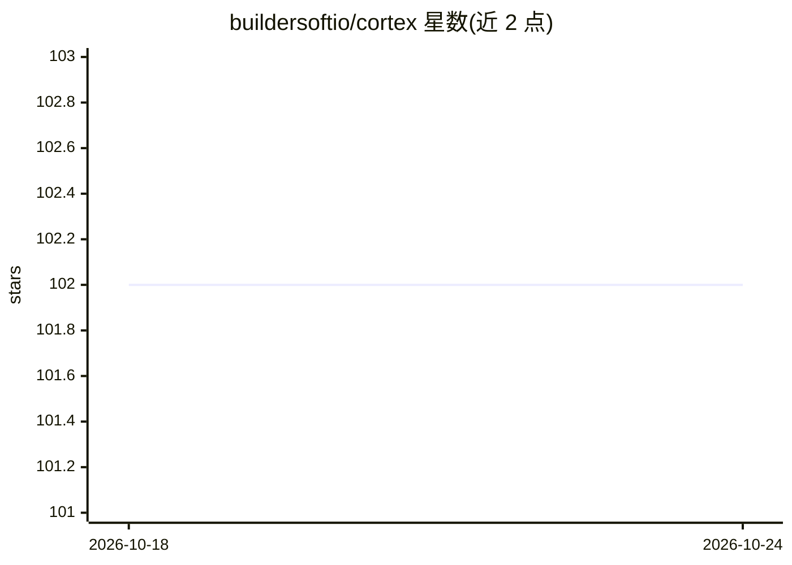

# buildersoftio/cortex

⭐ 102 · C# · MIT · 推送 2026-02-24 · [GitHub](https://github.com/buildersoftio/cortex) · [官网](https://buildersoft.io/cortex) · 组织维护

**.NET 实时数据流处理与状态管理框架**

面向 .NET 开发者的模块化数据处理框架，以 StreamBuilder 风格 API 构建实时流处理管道（Source/Map/Filter/GroupBy/Aggregate/Sink），并内置线程安全的状态存储抽象。提供约 30 个 NuGet 包：流集成覆盖 Kafka、Pulsar、RabbitMQ、AWS SQS、Azure Service Bus 等消息系统，CDC 适配器支持 SQL Server/PostgreSQL/MongoDB，状态存储可选 RocksDB、Cassandra、ClickHouse、DuckDB 等十余种后端，遥测支持 OpenTelemetry。另含 Mediator 模式实现与面向 AI 的向量类型库（Dense/Sparse/Bit）。

## 筛选速览

| 维度 | 判定 | 备注 |
|---|---|---|
| AI 角色 | `ai-ecosystem` | LLM/agent 周边工具 |
| 许可风险 | `permissive` | MIT |
| 部署形态 | `None` |  |
| 模型依赖 | — | README 未给出锁定关系 |
| 硬件要求 | — | 无带数字的原话,不猜 |
| 安装摩擦 | `medium` | 含编译或系统依赖之一 |
| 成熟度 | — | 结构信号不足 |

## 能力要点

- StreamBuilder API 构建 Source→Map→Filter→Aggregate→Sink 管道
- 30 个左右的模块化 NuGet 包，流/状态/连接器可按需组合
- 状态存储支持 RocksDB、Cassandra、ClickHouse、DuckDB 等十余种后端
- Kafka/Pulsar/RabbitMQ/SQS/Azure Service Bus 等消息系统集成

## 适用场景

- 构建实时分析与事件驱动架构
- 有状态流处理（聚合、join）与数据富化管道
- 通过 CDC 适配器从 SQL Server/PostgreSQL/MongoDB 捕获变更

## 场景标签

 · 领域:数据工程/流处理

## 证据(README 行号)

> L135: - **Cortex.Vectors:** is a High‑performance vector types—Dense, Sparse, and Bit—for AI.
> L5: **Cortex Data Framework** is a robust, extensible platform designed to facilitate real-time data streaming, processi

## 星数曲线

2026-10-18 102 → 2026-10-24 102（+0）

---
*卡片 v1 · prompt 1.4 · 生成 2026-10-23 · 置信度 mid · 依据 README sha `5cffe423241c` · [字段定义](../../DATASET.md)*
