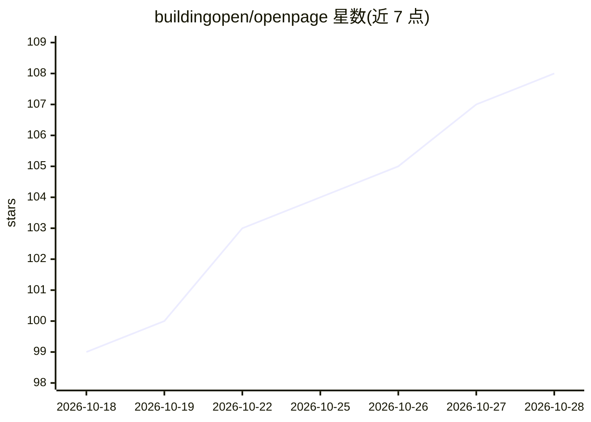

# buildingopen/openpage

⭐ 110 · TypeScript · MIT · 推送 2026-03-07 · [GitHub](https://github.com/buildingopen/openpage) · [官网](https://openpage-phi.vercel.app) · 组织维护

**开源可视化建站工具：拖拽编辑 + AI 生成，JSON 为唯一事实源**

基于 React 19 + TypeScript + Tailwind CSS 的开源自托管建站工具。提供 Framer 式可视化拖拽编辑器（实时预览、块重排、内联编辑），以及经 Gemini API 从文本提示生成完整站点的 AI 端点（POST /api/generate 返回结构化 SiteConfig JSON）。站点全部由带类型 schema 的 JSON 描述，可视化编辑与 AI 生成都读写同一 JSON，可 diff、可版本控制。支持一键导出自包含 HTML 文件（内联样式、CDN Tailwind、零运行时依赖）。含 19 种块类型、42 种布局变体、10 套主题预设。MIT 许可。

## 筛选速览

| 维度 | 判定 | 备注 |
|---|---|---|
| AI 角色 | `ai-enhanced` | 去掉 AI 部分产品仍成立 |
| 许可风险 | `permissive` | MIT |
| 部署形态 | `library` | 以包/库形式分发 |
| 模型依赖 | — | README 未给出锁定关系 |
| 硬件要求 | — | 无带数字的原话,不猜 |
| 安装摩擦 | `low` | 无编译、无系统依赖或容器化 |
| 成熟度 | — | 结构信号不足 |

## 能力要点

- JSON-first 架构：可视化编辑与 AI 生成读写同一结构化 JSON
- AI 端点 POST /api/generate 返回完整 SiteConfig（Gemini 后端，可换其他 LLM）
- 一键导出自包含 HTML，零运行时依赖，可部署任意静态托管
- 19 种块类型、42 种布局变体、10 套主题预设

## 适用场景

- 从文本提示生成落地页再可视化微调
- 让 AI agent 通过结构化 API 精确编辑站点而非生成代码
- 以 JSON 版本控制营销页，在 PR 中以干净 diff 审查变更
- Fork 作为白标建站产品的基础

## 场景标签

 · 领域:Web 开发/建站工具

## 证据(README 行号)

> L16: - **Visual drag-and-drop editor** with real-time preview, block reordering, and inline editing
> L17: - **AI website generation** from a text prompt via Gemini (POST a prompt, get back a complete site)
> L186: Yes. OpenPage is fully self-hostable. Clone the repo, run `npm install && npm run dev`, and the editor runs locall

## 星数曲线

2026-10-18 99 → 2026-10-28 108（+9）

---
*卡片 v1 · prompt 1.4 · 生成 2026-10-23 · 置信度 mid · 依据 README sha `2e57e5fe7a57` · [字段定义](../../DATASET.md)*
