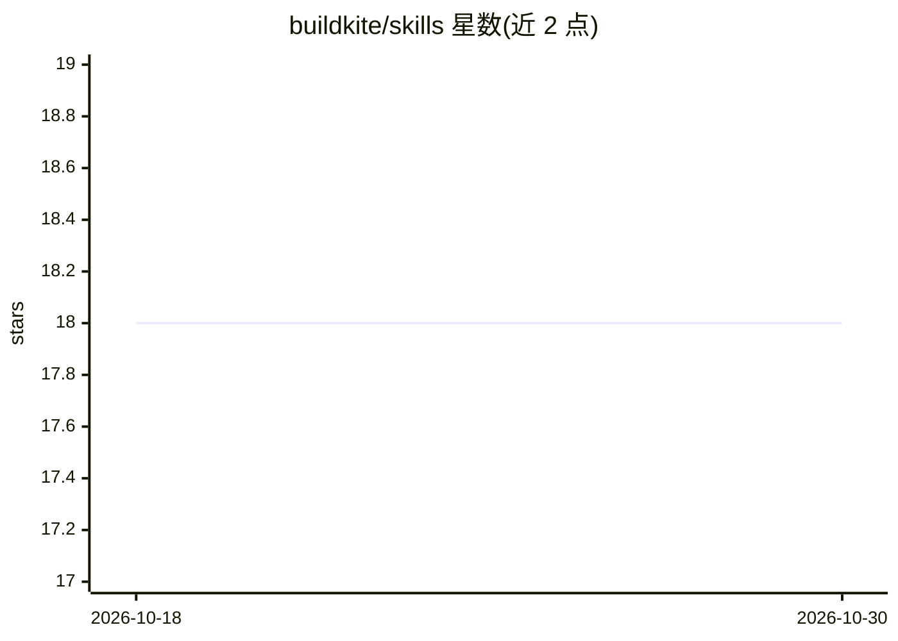

# buildkite/skills

⭐ 18 · Python · MIT · 推送 2026-10-22 · [GitHub](https://github.com/buildkite/skills) · 组织维护

**Buildkite 官方为 AI 编程 agent 提供的技能包集合**

Buildkite 官方维护的技能（skills）仓库，面向 Claude Code、Cursor、Kiro 等 AI 编程 agent：安装后 agent 可生成正确的 pipeline YAML、执行 bk 与 buildkite-agent CLI 命令、调用 REST/GraphQL API、配置 agent 及运行 preflight 构建。包含 7 个技能，覆盖管道、CI 迁移（GitHub Actions/Jenkins/CircleCI 等转换）、preflight、agent 运行时、缓存、CLI 与 API。技能编码专家经验而非文档复述，附 references 子目录按需加载。

## 筛选速览

| 维度 | 判定 | 备注 |
|---|---|---|
| AI 角色 | `ai-knowledge` | 知识聚合/清单类 |
| 许可风险 | `permissive` | MIT |
| 部署形态 | `library` | 以包/库形式分发 |
| 模型依赖 | — | README 未给出锁定关系 |
| 硬件要求 | — | 无带数字的原话,不猜 |
| 安装摩擦 | `low` | 无编译、无系统依赖或容器化 |
| 成熟度 | — | 结构信号不足 |

## 能力要点

- 7 个技能覆盖 pipeline YAML、CLI、API、缓存、preflight 等
- 支持从 GitHub Actions/Jenkins/CircleCI/Bitbucket/GitLab CI 迁移转换
- 兼容 Claude Code 插件、Cursor Marketplace、Kiro power/skills 及通用 skills 目录
- SKILL.md 提供推荐模式与陷阱表，详细参考置于 references/ 按需加载

## 适用场景

- 让 AI 编程 agent 生成正确的 Buildkite pipeline YAML
- 把现有 CI 从 GitHub Actions/Jenkins 等迁移到 Buildkite
- 让 agent 通过 bk CLI 与 API 操作构建、制品与密钥

## 场景标签

`提示工程` · 领域:Agent 开发

## 证据(README 行号)

> L3: The official Buildkite skills for Claude Code, Cursor, and other AI coding
> L4: agents. Install them into your agent of choice so it can generate correct
> L5: pipeline YAML, run `bk` and `buildkite-agent` CLI commands, call the API,
> L78: Skills serve a different purpose: they encode **expertise**. Where docs explain every

## 星数曲线

2026-10-18 18 → 2026-10-30 18（+0）

---
*卡片 v1 · prompt 1.4 · 生成 2026-10-29 · 置信度 high · 依据 README sha `5ded0e6dcd36` · [字段定义](../../DATASET.md)*
