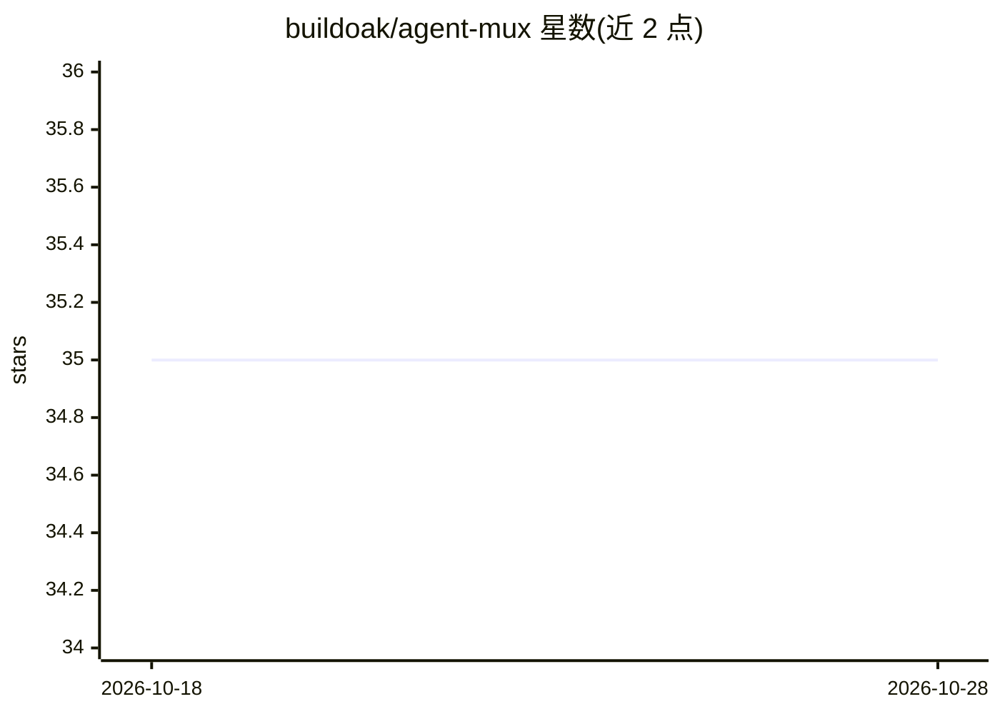

# buildoak/agent-mux

⭐ 35 · Go · MIT · 推送 2026-07-10 · [GitHub](https://github.com/buildoak/agent-mux) · 组织维护

**给 AI 编程助手的跨引擎调度层：一个 CLI 统一调度多个编码代理**

用 Go 编写的 CLI 工具，作为 Codex、Claude Code、Gemini CLI、实验性 agy 与 Grok Build CLI 五种 AI 编码 harness 的统一调度层：通过单一 JSON 结果契约封装各引擎差异，worker 以带 YAML frontmatter 的 markdown 文件定义，profile 一次加载引擎/模型/effort/超时/系统提示词。提供异步派发、两阶段超时、恢复与转向信号、事件流、hooks、技能注入与每次派发的持久化产物。引擎 CLI 需单独安装，agent-mux 不捆绑；认证支持各引擎 OAuth 订阅或 API key 环境变量。安装途径为 brew、go install 或源码编译。

## 筛选速览

| 维度 | 判定 | 备注 |
|---|---|---|
| AI 角色 | `ai-ecosystem` | LLM/agent 周边工具 |
| 许可风险 | `permissive` | MIT |
| 部署形态 | `library` | 以包/库形式分发 |
| 模型依赖 | locked-api |  |
| 硬件要求 | — | 无带数字的原话,不猜 |
| 安装摩擦 | `low` | 无编译、无系统依赖或容器化 |
| 成熟度 | `idea` | |

## 能力要点

- 五个引擎（codex/claude/gemini/agy/grok）统一为单一 JSON 结果契约
- Profile 式派发：markdown+frontmatter 一次定义引擎、模型、effort、超时与系统提示词
- 异步派发、两阶段超时、恢复上下文与事件流（NDJSON on stderr）
- 每次派发写入 meta.json 与 result.json，产物跨超时与进程死亡持久化

## 适用场景

- 让调用方 LLM 用同一接口调度不同厂商的编码代理
- 用 markdown 文件维护可复用的 worker 提示词与默认参数
- 异步发起编码任务并稍后用 wait/result 收取结果

## 场景标签

`编码 Agent` `Agent 框架` · 领域:Agent 开发

## 证据(README 行号)

> L3: Cross-engine dispatch layer for built-in harness adapters: codex, claude, gemini, experimental agy, and Grok Build C
> L17: 1. **Tool, not orchestrator.** The calling LLM decides what to do. agent-mux handles the how.

## 星数曲线

2026-10-18 35 → 2026-10-28 35（+0）

---
*卡片 v1 · prompt 1.4 · 生成 2026-10-25 · 置信度 high · 依据 README sha `4d4200aa024c` · [字段定义](../../DATASET.md)*
