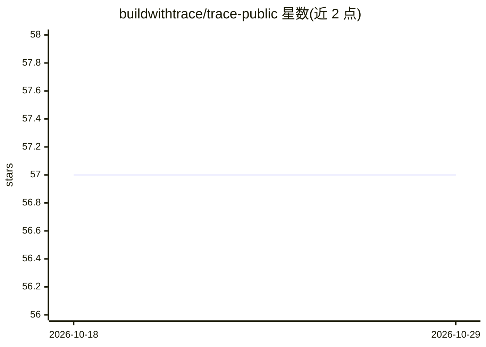

# buildwithtrace/trace-public

⭐ 57 · C++ · GPL-3.0 · 推送 2026-05-11 · [GitHub](https://github.com/buildwithtrace/trace-public) · [官网](https://docs.buildwithtrace.com) · 组织维护

**面向硬件工程师的 AI 增强 KiCad 分支 PCB 设计套件**

Trace 是基于 KiCad 的独立分支 EDA 软件，保留原理图编辑、PCB 布局、3D 查看等核心功能，并加入 AI 电路助手：自然语言描述电路生成与修改、AI 元器件搜索建议、AI 优化自动布线，以及云同步协作。整体以 GPLv3 发布，但 trace/ 目录下的 AI 模块为专有许可（All Rights Reserved），仅提供参考；AI 功能需注册账号，后端 API 专有不在仓库内。提供官网安装包下载，也可从源码构建（CMake/C++17/wxPython）。

## 筛选速览

| 维度 | 判定 | 备注 |
|---|---|---|
| AI 角色 | `ai-enhanced` | 去掉 AI 部分产品仍成立 |
| 许可风险 | `viral` | GPL-3.0 |
| 部署形态 | `None` |  |
| 模型依赖 | — | README 未给出锁定关系 |
| 硬件要求 | — | 无带数字的原话,不猜 |
| 安装摩擦 | `medium` | 含编译或系统依赖之一 |
| 成熟度 | — | 结构信号不足 |

## 能力要点

- 自然语言电路设计与修改的 AI Circuit Assistant
- AI 元器件搜索与低功耗等场景选型建议
- AI 优化自动布线
- 保留 KiCad 原有 PCB/原理图/3D 查看等 EDA 功能

## 适用场景

- 用自然语言描述需求快速生成电路（如 555 定时器电路）
- 设计 PCB 时获取元器件选型建议并自动布线
- 需要 KiCad 兼容工作流并加入 AI 辅助的硬件开发

## 场景标签

 · 领域:电子设计自动化（EDA）/硬件工程

## 证据(README 行号)

> L3: **Trace is a modified version of the KiCad EDA software, enhanced with AI-native circuit design capabilities.**
> L14: - **AI Circuit Assistant**: Natural language circuit design and modification

## 星数曲线

2026-10-18 57 → 2026-10-29 57（+0）

---
*卡片 v1 · prompt 1.4 · 生成 2026-10-24 · 置信度 high · 依据 README sha `1fb269288835` · [字段定义](../../DATASET.md)*
